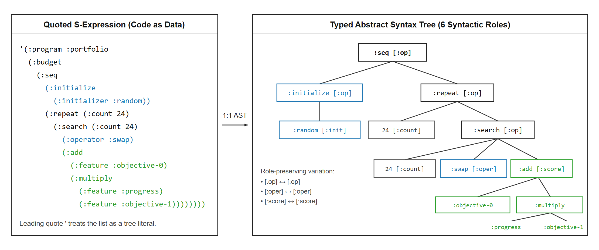
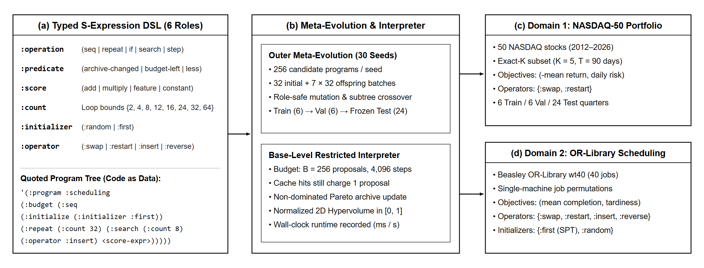
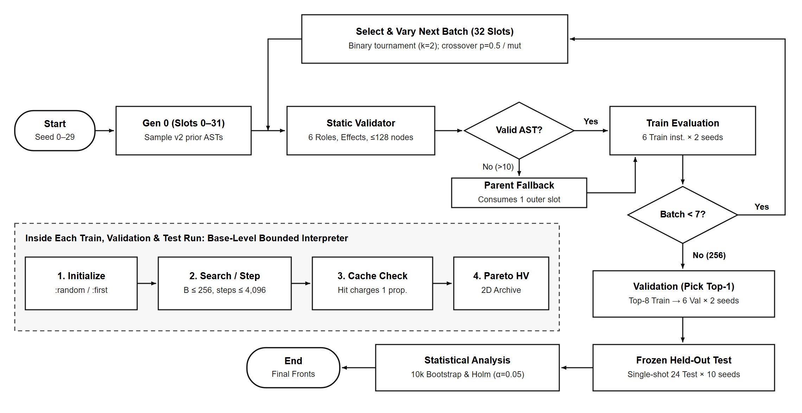
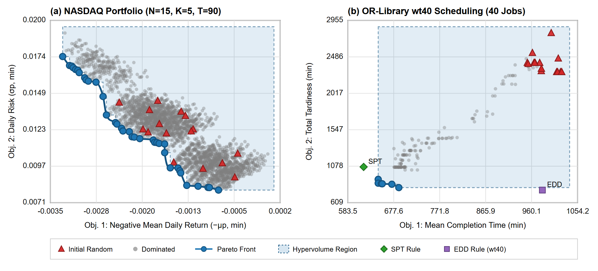
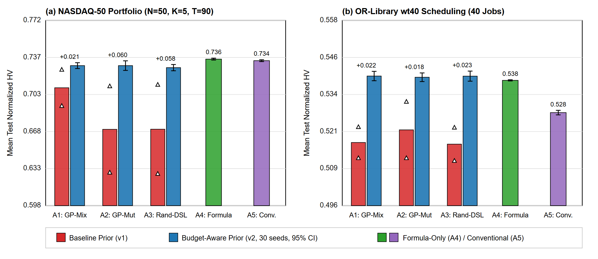
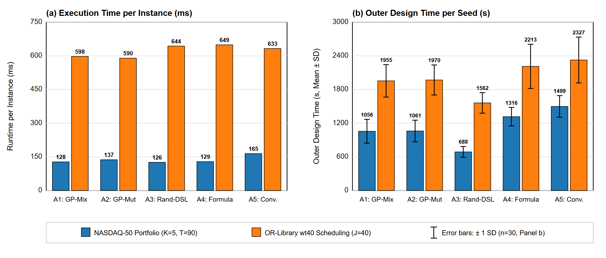
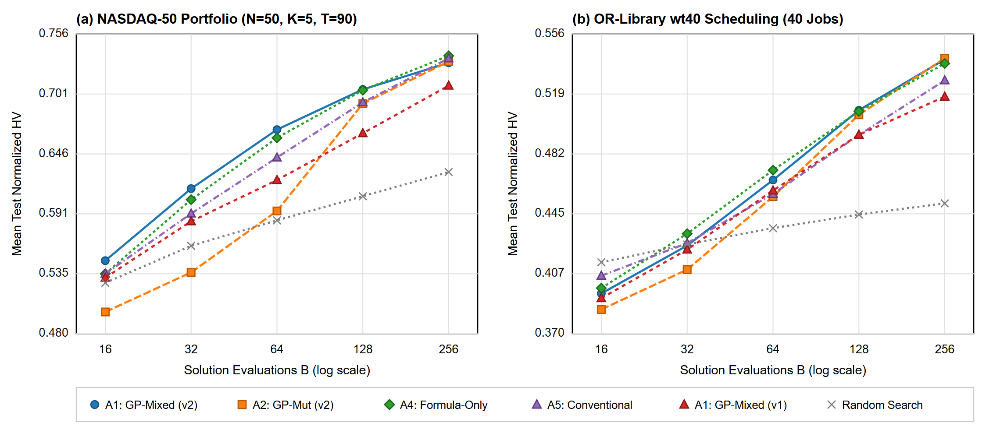
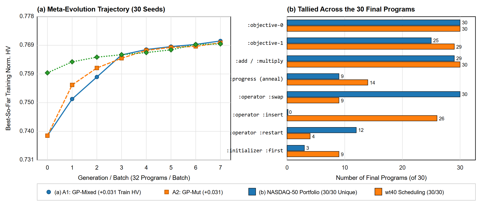

# Evolution of Multi-Objective Optimization Hyper-Heuristics via Genetic Programming with Typed S-Expressions in Clojure

**Nikolay Penchev**$^{1}$, **Angel Marchev, Jr.**$^{2}$  
e-mail: ndpenchev@uni-sofia.bg$^{1}$, e-mail: angel.marchev@unwe.bg$^{2}$

---

## Abstract

This study investigates multi-objective optimization hyper-heuristics built from typed symbolic expressions (S-expressions) via Genetic Programming in Clojure. The system evolves complete executable search procedures encoded as quoted list trees, validates them against static role and effect rules, and runs them inside a bounded interpreter. Across 30 independent runs on non-overlapping NASDAQ-50 equity windows (2012–2026, selecting 5 of 50 assets) and 40-job OR-Library `wt40` scheduling instances, we evaluate five search configurations under a 256-evaluation budget: mixed GP, mutation-only GP, equal-budget random grammar sampling, fixed-template formula evolution, and configured conventional baselines (NSGA-II, Pareto Local Search, and Multi-Start Restart). On `wt40` scheduling, evolved programs reach a mean normalized hypervolume of 0.53974 (597.5 ms per instance), beating conventional baselines (0.52751, 632.8 ms) in 28 of 30 seeds while lowering compromise completion time and total tardiness. On NASDAQ-50 portfolios, evolved programs execute 22% faster (127.7 versus 164.6 ms), achieve a higher return-to-risk ratio (4.33 versus 4.24), and match conventional hypervolume (0.72975 versus 0.73440) within a 0.01 equivalence band. Ablation checks show that budget-aware initialization (+0.02110 to +0.02316) and static role typing account for most of this gain.

**Key words:** Genetic Programming, Typed S-Expressions, Clojure, Multi-Objective Optimization, Hyper-Heuristics  
**JEL:** C61, C63, G11

---

## Introduction

Automated algorithm design treats the search procedure itself as the object of optimization. Conventional metaheuristics fix initialization, neighborhood moves, and acceptance criteria, so search operates only on candidate parameters. When problem structure shifts or conflicting objectives trade off, rigid templates often require manual redesign. In earlier studies, we compared evolutionary methods against exact dynamic programming on knapsack portfolios (Penchev & Marchev, 2026b) and evolved single-objective knapsack optimizers via typed symbolic expressions (Penchev & Marchev, 2026a). Both studies confirmed that evolutionary search handles discrete constraints well and keeps symbolic logic readable.

Our earlier typed S-expression setup left four open questions. Costs and profits were independent, a built-in `return-per-cost` rule supplied nearly all solution quality, mutation ran without subtree crossover, and no equal-budget random grammar control existed. Here we test four questions directly. Can typed S-expression evolution build multi-objective hyper-heuristics without preset greedy rules? Does one framework transfer from historical equities to job scheduling? What gain do crossover and evolutionary selection add over random grammar sampling and formula tuning? Finally, how do evolved programs compare with tuned conventional baselines?

We test this in Clojure across 30 seeds on historical NASDAQ-50 returns (`2012-01-03` to `2026-02-27`) and J. E. Beasley's OR-Library `wt40` scheduling suite (Beasley, 1990). Every synthesized tree stays compact (averaging 18.7 to 19.2 AST nodes) and terminates inside strict bounds. Mixed GP beats conventional baselines on `wt40` scheduling (`+0.01222` HV, *p* < 0.0001, 28/30 seeds) and matches them on NASDAQ-50 within the `0.01` equivalence band while running 22% faster with higher return-to-risk ratios.

---

## Theoretical Aspects

### Lisp, Clojure, and Homoiconicity

Treating programs as symbolic trees originates in McCarthy's (1960) Lisp formalism of S-expressions and `eval`. Clojure (Hickey, 2008) adapts Lisp to the Java Virtual Machine with immutable persistent lists `(...)`, vectors `[...]`, maps `{...}`, and keywords (`:keyword`). Because persistent collections share memory across edits, replacing a subtree yields a new tree without mutating parent programs in the population.

Homoiconicity means source code and the abstract syntax tree (AST) share one list format. Mainstream languages parse infix text into hidden compiler trees, whereas Clojure treats a quoted form like `'(:add (:feature :objective-0) (:multiply (:feature :progress) (:feature :objective-1)))` directly as an unevaluated tree (Figure 1). Clojure macros transform unevaluated S-expressions in the same structural way (Hickey, 2008). Our system uses a bounded interpreter rather than host macro expansion, yet initialization, mutation, and crossover still manipulate quoted trees as plain data without parsing or dynamic compilation.

  
Source: Authors' own elaboration based on the implemented typed S-expression domain-specific language.  
Figure 1: Homoiconic correspondence between a quoted Clojure S-expression optimizer and its six-role typed abstract syntax tree

### Genetic Programming, Typed Grammars, and Hyper-Heuristics

Koza (1992) grounded tree-based Genetic Programming (GP) in Lisp S-expressions so subtrees could swap freely under syntactic closure. Closure breaks when evolved optimizers mix loop counts, boolean guards, move operators, and floating-point scores, since untyped edits place subtrees in incompatible slots. Strongly Typed GP (Montana, 1995) and grammar-guided GP (Ryan et al., 1998; McKay et al., 2010) prevent invalid programs through explicit slot types. Later work explores higher-order functional types (`HOTGP`; Fernandes et al., 2023), initialization bias against random grammar sampling (Dick & Whigham, 2022), iterative solver synthesis (Parthasarathy et al., 2024), and semantics-aware variation (Wyrwiński & Krawiec, 2025).

Hyper-heuristics automate algorithm construction rather than problem-space tuning (Burke et al., 2013), spanning linear GP (Oltean, 2005), modular MOEA assembly (`AutoMOEA`; Bezerra et al., 2016), and program synthesis (Gulwani et al., 2017). Three recent tracks stand out. In scheduling, multi-objective GP evolves cloud workflow rules (Zaki et al., 2024; Sun et al., 2024). In finance, exact-*K* methods model sparse or robust portfolios (Kobayashi et al., 2023; Lapucci & Mansueto, 2024). Hybrid systems (`FunSearch`, Romera-Paredes et al., 2024; `EoH`, Liu et al., 2024) pair large language models with evolutionary search. Table 1 maps these streams to our study.

Table 1: Main literature streams, recent advances, and positioning of the present study

| Stream | Key Sources | Main Idea and Recent Advances | Role in the Present Research |
| :--- | :--- | :--- | :--- |
| Lisp, Clojure, Homoiconicity | McCarthy (1960); Hickey (2008) | Code and tree data share `'(:op ...)` lists; Clojure adds persistent structures. | Optimizers are immutable S-expressions validated and executed without compilation. |
| GP & Adaptive Operators | Koza (1992); Wyrwiński & Krawiec (2025) | Tree crossover/mutation; recent learned semantics-aware variation operators. | Drives the outer evolutionary loop (`:gp-mixed` vs. `:gp-mutation-only`). |
| Typed & Grammar-Guided GP | Montana (1995); Ryan et al. (1998); McKay et al. (2010); Dick & Whigham (2022); Fernandes et al. (2023) | Role/grammar constraints enforce valid subtrees; recent focus on prior bias and higher-order types. | Enforces six roles and static effects while ablating `v1`/`v2` priors and untyped edits. |
| Hyper-Heuristics | Oltean (2005); Burke et al. (2013); Bezerra et al. (2016); Zaki et al. (2024); Sun et al. (2024) | Evolves dispatching rules or modular MOEAs for scheduling and combinatorial optimization. | Co-evolves multi-stage control flow and dynamic bi-objective scores in one AST. |
| Synthesis & LLM-EC | Gulwani et al. (2017); Parthasarathy et al. (2024); Romera-Paredes et al. (2024); Liu et al. (2024) | Synthesizes multigrid solvers via G3P or pairs LLMs with evolutionary evaluators. | Replaces opaque LLMs with an auditable deterministic grammar and random-DSL controls. |
| Sparse Portfolios & Prior Work | Kobayashi et al. (2023); Lapucci & Mansueto (2024); Penchev & Marchev (2026a, 2026b) | Exact-*K* robust/sparse portfolios and 1-objective knapsack S-expressions. | Drops greedy presets and tests bi-objective NASDAQ-50 and OR-Library `wt40`. |
| **Present Study** | **Current manuscript (2026)** | **Six-role Clojure S-expressions co-evolving control flow and scalarizations across NASDAQ-50 and `wt40`.** | **Isolates `v2` prior, role typing, H1–H4 controls, runtime, and AST ablations.** |

Source: Authors' own synthesis based on the cited literature.

### Research Gap Addressed

Four gaps motivate this work. First, scheduling hyper-heuristics (Zaki et al., 2024; Sun et al., 2024) evolve priority rules in fixed simulators, and `AutoMOEA` (Bezerra et al., 2016) tunes fixed templates. Neither tests whether one typed DSL can co-evolve control flow and bi-objective scoring across both finance and scheduling. Second, LLM-evolutionary hybrids (Romera-Paredes et al., 2024; Liu et al., 2024) mix pretrained priors with evolution, requiring equal-budget random controls (Dick & Whigham, 2022). Third, recent exact-*K* portfolio solvers (Kobayashi et al., 2023; Lapucci & Mansueto, 2024) produce mathematical formulations instead of readable trees. Fourth, our earlier knapsack study (Penchev & Marchev, 2026a) relied on a preset greedy rule and omitted crossover and random-DSL controls. We close these gaps under equal-budget accounting on frozen public benchmarks.

---

## Methods

### Six-Role Typed DSL, Static Effects, and Bounded Interpreter

We build a binder-free typed Clojure DSL rooted at `'(:program <domain> (:budget <operation>))` (Figure 2). Every AST node belongs to one of six disjoint syntactic roles:

- **Control flow (`:operation`):** `:noop`, `:seq`, `:repeat`, `:if`, `:initialize`, `:step`, and `:search`.
- **Loop bounds (`:count`):** bounded iteration steps in $\{2, 4, 8, 12, 16, 24, 32, 64\}$.
- **Initializers (`:initializer`) and moves (`:operator`):** `:random` or `:first` starts paired with domain neighborhood operators.
- **Guards (`:predicate`):** boolean tests `:not`, `:and`, `:less`, `:archive-changed`, `:budget-left`, and `:coin`.
- **Acceptance (`:score`):** scalarization trees built from `:objective-0`, `:objective-1`, `:progress`, constants, `:add`, and `:multiply`.

With no free variables, exchanging same-role subtrees always preserves syntax. Static checks enforce effect permissions (`:pure`, `:control`, `:state`) and cap programs at 128 AST nodes, depth 12, and count 256.

  
Source: Authors' own elaboration based on the implemented Clojure architecture.  
Figure 2: Architecture of the typed S-expression optimizer framework showing (a) six-role DSL, (b) meta-evolution and bounded interpreter, and (c, d) benchmark adapters

A bounded interpreter limits execution steps and caps each instance at $B = 256$ candidate proposals. Under `cache? = true`, revisited solutions reuse stored objectives but still charge 1 proposal against $B = 256$, keeping Pareto archives bitwise identical. We compare two initialization priors (Dick & Whigham, 2022): `development-only-v1`, which places single-step leaves at top-level branches and stops early, against `budget-aware-v2`, which nests `:seq`, `:repeat`, and `:search` blocks aligned with 256 proposals. Figure 3 traces this full two-level workflow.

  
Source: Authors' own elaboration based on the implemented experimental pipeline.  
Figure 3: Complete workflow of outer meta-evolution, static validation, base-level bounded interpretation, and held-out testing

### Benchmark Formulations and Normalized Hypervolume

Each benchmark splits 36 frozen instances into 6 training, 6 validation, and 24 test instances. **Exact-K Portfolio Selection (`:portfolio`)** covers 50 liquid NASDAQ equities (`2012-01-03` to `2026-02-27`), yielding `3,559` trading dates and `3,558` daily simple return vectors. We slice this timeline into 36 non-overlapping $T = 90$-day windows separated by 8-trading-day embargo gaps (6 train `2012–2014`, 6 validation `2014–2016`, 24 test `2016–2025`), preventing look-ahead leakage. Evaluated in `DECIMAL128` arithmetic, each equal-weight $K = 5$ portfolio minimizes negative mean daily return and sample standard deviation:

$$\min_{x \in \{0,1\}^N} \left( f_1(x) = -\bar{R}_p(x),\; f_2(x) = s_p(x) \right), \quad \text{s.t. } \sum_{i=1}^{N} x_i = K \qquad (1)$$

Portfolio moves preserve cardinality via `:swap` and `:restart`, with `:first` and `:random` initializers. **Bi-Objective Single-Machine Scheduling on OR-Library `wt40` (`:scheduling`)** (Beasley, 1990) draws 36 stratified 40-job instances ($J = 40$; $\text{RDD}, \text{TF} \in \{0.2, \dots, 1.0\}$). Each job permutation $\pi \in \mathfrak{S}_J$ minimizes mean completion time and total tardiness:

$$\min_{\pi \in \mathfrak{S}_J} \left( f_1(\pi) = \frac{1}{J}\sum_{j=1}^{J} C_{\pi(j)},\; f_2(\pi) = \sum_{j=1}^{J} \max\left(0, C_{\pi(j)} - d_{\pi(j)}\right) \right) \qquad (2)$$

Scheduling moves include `:insert`, `:swap`, `:reverse`, `:restart`, and Shortest Processing Time (`:first`). Quality is measured by normalized 2D hypervolume over fixed bounds in $[0,1]^2$ with reference $r = (1.05, 1.05)$ (divisor $1.1025$):

$$\mathrm{HV}_{\mathrm{norm}}(\mathcal{P}) = \frac{1}{1.1025} \sum_{m=1}^{|\mathcal{P}'|} \left(1.05 - z_1^{(m)}\right)\left(z_2^{(m-1)} - z_2^{(m)}\right), \quad z_2^{(0)} = 1.05 \qquad (3)$$

Figure 4 shows representative discrete Pareto fronts as orthogonal hypervolume staircases alongside monotone cubic curves.

  
Source: Authors' own experimental runs on frozen benchmark instances.  
Figure 4: Representative non-dominated Pareto fronts on real NASDAQ portfolio selection ($N=15, K=5, T=90$) and OR-Library `wt40` scheduling ($J=40$ jobs; green diamond: classical SPT rule minimizing completion time; purple square: classical EDD rule minimizing due-date violations)

### Experimental Protocol, Ethics, and Reproducibility Statement

Across 30 independent outer seeds (`0..29`), each arm runs 256 outer assessments on 6 training instances, freezes 1 top validation candidate, and tests it once on 24 held-out instances (Table 2, Table 3). Five arms are evaluated:

- **Full GP (`A1: :gp-mixed`) and Mutation-Only GP (`A2: :gp-mutation-only`):** evolve `v2` ASTs using subtree mutation with crossover ($p_c = 0.5$) or without crossover ($p_c = 0.0$).
- **Random DSL (`A3: :random-dsl`):** draws 256 independent `v2` trees without selection.
- **Formula-Only (`A4: :formula-only`):** evolves only `:score` expressions inside a fixed `:swap` scaffold.
- **Configured Baselines (`A5: :configured-conventional`):** validation-tunes NSGA-II, Pareto Local Search, and Multi-Start Restart across 256 configurations.

Four paired hypotheses (**H1**: `A1` vs. `A3`; **H2**: `A1` vs. `A4`; **H3**: `A1` vs. `A2`; **H4**: `A1` vs. `A5`) use 10,000-resample paired bootstrap CIs, Holm-Bonferroni correction ($\alpha = 0.05$), and $\Delta_{\mathrm{prac}} = 0.01$. Complete Clojure source code, test suites, frozen configurations, replication logs, and the NASDAQ-50 script are publicly archived (Penchev & Marchev, 2026c).

**Ethics Approval and Originality Statement.** This study uses only public historical equity series (NASDAQ-50) and OR-Library `wt40`; no human subjects, personal data, or animal experiments are involved. All work is original, cited under APA 7th rules, free of plagiarism or unverified fabrication, and not submitted elsewhere.

Table 2: Main experimental parameters across both benchmark domains

| Parameter | NASDAQ-50 Portfolio (`:portfolio`) | OR-Library `wt40` Scheduling (`:scheduling`) |
| :--- | :--- | :--- |
| Source & Representation | Daily returns (`2012-01-03`–`2026-02-27`), $N=50, K=5, T=90$ | Beasley `wt40` (`J = 40` jobs), stratified RDD/TF |
| Splits & Budgets | 6 train / 6 val / 24 test; 30 seeds × 256 outer × 256 base | 6 train / 6 val / 24 test; 30 seeds × 256 outer × 256 base |
| AST & Stats | Max 128 nodes, depth 12; bootstrap (10,000), Holm ($\alpha=0.05$) | Max 128 nodes, depth 12; bootstrap (10,000), Holm ($\alpha=0.05$) |

Source: Authors' experimental design.

Table 3: Fixed hyperparameters and configured conventional baseline search space

| Component | Parameter | Fixed Value / Search Space |
| :--- | :--- | :--- |
| **Outer GP (`A1`–`A4`)** | Seeds & Outer Slots | `30` seeds (`0..29`); `256` slots (`32` initial + `7 × 32` batches) |
| | Selection & Variation | Binary tournament (`k = 2`); crossover `0.5` (`A1`, `0.0` `A2`); `<= 10` retries/slot |
| | Validation & Tie-Breaks | Top `8` train finalists to val (`6 × 2` runs), pick top `1` (nodes, SHA-256 ID) |
| | `A4` Fixed Scaffold | `(:seq (:initialize :random) (:repeat 16 (:search 16 :swap <score>)))` (max `15` nodes, depth `5`) |
| **DSL & Interpreter** | AST Bounds & `v2` Constants | Max `128` nodes, depth `12`, count `256`; counts `{2, 4, 8, 12, 16, 24, 32, 64}`; constants `[-4.0, 4.0]` |
| | Inner Budget & Seeds | `B = 256` proposals, `<= 4,096` steps, `cache? = true` (`1` prop./hit); `2` train / `2` val / `10` test seeds |
| **Baselines (`A5`)** | NSGA-II Grid | `population-size` $\in \{4, 8, 16, 32\}$; `perturbation-steps` $\in \{1, 2, 3\}$ |
| (`256` samples/seed) | Pareto Local Search (PLS) | `initial-starts`, `neighbors-per-step` $\in \{1, 2, 4, 8\}$; rule `{unvisited, crowding, random}` |
| | Multi-Start Restart | `restart-period` $\in \{4, 8, 16, 32\}$; weights `{balanced, alternating, uniform-grid}` |

Source: Authors' frozen experimental configuration, available in the authors' GitHub repository (Penchev & Marchev, 2026c).

---

## Results and Discussion

### Five-Arm Performance and Computational Speed Across 30 Seeds

Table 4, Figure 5, and Figure 6 report 30-seed test hypervolume, front size ($\|ND\|$), per-instance runtime, outer design time, candidate diversity, and node count. All typed DSL runs (`A1`–`A3`) ran without runtime errors and yielded 30 unique ASTs (`14.1`–`19.2` nodes), exploring `243.9` to `253.0` distinct candidates per 256 outer slots. By comparison, fixed-template `:formula-only` converges earlier (`162.4` and `160.9` distinct candidates; `9/30` and `19/30` unique final formulas). Because `:gp-mixed` avoids generational sorting and crowding-distance updates, it runs a NASDAQ-50 window in `127.7 ms`, which is 22% faster than `:configured-conventional` (`164.6 ms`; Figure 6a). On `wt40`, `:gp-mixed` finishes in `597.5 ms` versus `632.8 ms`. Outer design times (`1056.3 s` and `1954.9 s`) also beat conventional tuning (`1499.1 s` and `2326.8 s`; Figure 6b).

Table 4: Thirty-seed test hypervolume, runtime, and structural summary (`budget-aware-v2` prior)

| Domain and Arm | Test HV (Mean ± SD) | Median (Min–Max) | Val. HV | $\|ND\|$ | Run (ms) | Design (s) | Distinct | Nodes | Unique |
| :--- | :---: | :---: | :---: | :---: | :---: | :---: | :---: | :---: | :---: |
| **NASDAQ-50 Portfolio** | | | | | | | | | |
| `A1: :gp-mixed` (`v2`) | $0.72975 \pm 0.00768$ | $0.73163$ (0.7118–0.7414) | $0.75509$ | $14.9$ | $127.7$ | $1056.3 \pm 211.6$ | $243.9$ | $18.9$ | $30/30$ |
| `A2: :gp-mutation-only` | $0.72974 \pm 0.01263$ | $0.73286$ (0.6738–0.7473) | $0.75449$ | $14.8$ | $137.2$ | $1061.1 \pm 192.8$ | $251.5$ | $19.2$ | $30/30$ |
| `A3: :random-dsl` (`v2`) | $0.72785 \pm 0.00822$ | $0.72656$ (0.7118–0.7385) | $0.75474$ | $14.8$ | **$125.7$** | **$688.4 \pm 95.5$** | $250.9$ | $14.2$ | $30/30$ |
| `A4: :formula-only` (`v2`) | **$0.73587 \pm 0.00241$** | **$0.73646$** (0.7265–0.7374) | $0.75724$ | $15.6$ | $128.7$ | $1316.2 \pm 164.8$ | $162.4$ | $13.7$ | $9/30$ |
| `A5: :configured-conv.` | $0.73440 \pm 0.00241$ | $0.73423$ (0.7322–0.7409) | **$0.76167$** | **$16.9$** | $164.6$ | $1499.1 \pm 192.7$ | $150.1$ | $6.4$ | 18 NSGA-II, 12 PLS |
| **OR-Library `wt40`** | | | | | | | | | |
| `A1: :gp-mixed` (`v2`) | **$0.53974 \pm 0.00438$** | **$0.54164$** (0.5227–0.5433) | **$0.55240$** | $4.4$ | $597.5$ | $1954.9 \pm 289.2$ | $244.0$ | $18.7$ | $30/30$ |
| `A2: :gp-mutation-only` | $0.53933 \pm 0.00403$ | $0.54145$ (0.5259–0.5425) | $0.55182$ | $4.4$ | **$589.7$** | $1970.4 \pm 267.5$ | $253.0$ | $18.2$ | $30/30$ |
| `A3: :random-dsl` (`v2`) | $0.53970 \pm 0.00472$ | $0.54155$ (0.5235–0.5425) | $0.55109$ | $4.5$ | $643.7$ | **$1562.0 \pm 182.9$** | $252.9$ | $14.1$ | $30/30$ |
| `A4: :formula-only` (`v2`) | $0.53829 \pm 0.00054$ | $0.53838$ (0.5374–0.5391) | $0.54650$ | $3.7$ | $649.3$ | $2213.3 \pm 394.1$ | $160.9$ | $14.8$ | $19/30$ |
| `A5: :configured-conv.` | $0.52751 \pm 0.00212$ | $0.52786$ (0.5237–0.5301) | $0.54321$ | **$7.4$** | $632.8$ | $2326.8 \pm 408.3$ | $190.1$ | $6.4$ | 19 NSGA-II, 11 PLS |

Source: Authors' 30-seed experiments on NASDAQ-50 equities and OR-Library wt40 (bold marks best per column).

On `wt40`, `:gp-mixed` (`0.53974`) beats `:configured-conventional` (`0.52751`) by `+0.01222` HV across 28 of 30 seeds and exceeds `:formula-only` (`0.53829`). On NASDAQ-50, `:gp-mixed` outperforms `:configured-conventional` in 12 of 30 seeds (`0.72975` vs. `0.73440`), staying inside the `±0.01` equivalence band.

  
Source: Authors' 30-seed confirmatory and prior-ablation runs.  
Figure 5: Test normalized hypervolume across the five search arms and comparison of `budget-aware-v2` versus `development-only-v1` priors

  
Source: Authors' held-out timing runs (`cache? = true`) and 30-seed confirmatory outer logs.  
Figure 6: Base-level execution time per instance in ms (a) and one-time outer design time per seed in s, Mean ± SD across 30 seeds (b)

### Domain-Level Quality and Concrete Solutions

Table 5 translates Pareto fronts into concrete domain metrics averaged across all 24 held-out test instances:

- **NASDAQ-50 Front Coverage:** All four DSL arms achieve higher peak daily returns (`+0.378%` to `+0.380%`) and return-to-risk ratios (`4.33`–`4.43`) than `:configured-conventional` (`+0.371%`, `4.24`). Configured NSGA-II and PLS earn their `+0.00465` HV edge by extending the low-volatility corner (`0.845%` vs. `0.947%`) with extra points (`17.2` vs. `14.9`).
- **Concrete Equity Baskets:** On `nasdaq-test-0` (`2016–2017`), median `:gp-mixed` traces 17 portfolios from `(AAPL, ADP, COST, CSCO, ISRG)` (`11.28%` volatility) up to `(NVDA, AMD, CSX, FITB, HBAN)` (`+0.438%` daily return). On `nasdaq-test-23` (`late 2025`), it builds 14 portfolios spanning defensive `(AAPL, COST, CTSH, IDXX, PEP)` (`11.99%` volatility), balanced `(ASML, CTSH, GILD, MAR, MU)` (`+0.422%`, `4.94` return-to-risk), and growth `(GOOGL, INTC, KLAC, LRCX, MU)` (`+0.686%`).
- **Scheduling (`wt40`) Trade-offs:** Classical SPT lowers completion time (`734.5`) at high tardiness (`11,173.8`), while EDD worsens both metrics (`1,037.8` completion, `12,032.6` tardiness). Evolved `:gp-mixed` cuts minimum tardiness to `9,878.3` (`11.6%` below SPT) and dominates `:configured-conventional` at the knee schedule (`781.9 / 9,928.8` vs. `828.7 / 10,410.1`, saving `46.8` completion and `481.3` tardiness units).

Table 5: Concrete domain-level solution quality averaged across 24 held-out test instances (Mean ± 95% CI)

| Benchmark and Method | Extreme Objective 1 | Extreme Objective 2 | Compromise / Knee Quality | $\|ND\|$ |
| :--- | :---: | :---: | :---: | :---: |
| **NASDAQ-50 Portfolio** | **Max Daily Ret. (Ann. %)** | **Min Daily Risk (Ann. %)** | **Max Ann. Ret./Risk** | **Size** |
| `A1: :gp-mixed` (`v2`) | +0.379% (+95.53 ± 1.29%) | 0.947% (15.04 ± 0.28%) | 4.33 ± 0.05 | 14.9 |
| `A2: :gp-mutation-only` | +0.378% (+95.29 ± 1.25%) | 0.952% (15.11 ± 0.29%) | 4.37 ± 0.05 | 14.9 |
| `A3: :random-dsl` (`v2`) | **+0.380% (+95.87 ± 1.26%)** | 0.962% (15.27 ± 0.33%) | 4.33 ± 0.05 | 14.9 |
| `A4: :formula-only` (`v2`) | +0.379% (+95.44 ± 0.63%) | 0.935% (14.84 ± 0.26%) | **4.43 ± 0.02** | 15.9 |
| `A5: :configured-conv.` | +0.371% (+93.49 ± 0.41%) | **0.845% (13.42 ± 0.23%)** | 4.24 ± 0.04 | **17.2** |
| **OR-Library `wt40`** | **Min Completion ($f_1$)** | **Min Tardiness ($f_2$)** | **Knee ($f_1$ / $f_2$)** | **Size** |
| Classical SPT | **734.5** | 11,173.8 | 734.5 / 11,173.8 | 1.0 |
| Classical EDD | 1,037.8 | 12,032.6 | 1,037.8 / 12,032.6 | 1.0 |
| `A1: :gp-mixed` (`v2`) | **775.2 ± 3.6** | 9,878.3 ± 124.1 | **781.9 / 9,928.8** | 4.4 |
| `A2: :gp-mutation-only` | 779.7 ± 4.0 | 9,880.2 ± 101.5 | 786.9 / 9,934.9 | 4.4 |
| `A3: :random-dsl` (`v2`) | 777.6 ± 4.6 | **9,847.3 ± 149.1** | 784.6 / 9,895.1 | 4.5 |
| `A4: :formula-only` (`v2`) | 779.6 ± 2.6 | 9,903.2 ± 71.2 | 785.8 / 9,957.0 | 3.7 |
| `A5: :configured-conv.` | 794.9 ± 2.0 | 10,173.7 ± 49.3 | 828.7 / 10,410.1 | **7.4** |

Source: Authors' held-out test evaluations on 2016-2025 NASDAQ-50 quarters and OR-Library wt40 (bold marks best per column).

### Hypothesis Tests and Prior Ablation

Table 6 gives paired bootstrap contrasts across the 30 seeds. For **H1** (`:gp-mixed` vs. `:random-dsl`) and **H3** (`:gp-mixed` vs. `:gp-mutation-only`), mean differences are near zero with simultaneous CIs inside `[-0.01, +0.01]`. At 256 outer assessments under `v2`, mixed GP, mutation-only GP, and random grammar search perform equivalently on test HV. Under **H4**, `:gp-mixed` matches `:configured-conventional` on portfolios (`-0.00465`) and leads clearly on `wt40` (`+0.01222`, Holm *p* < 0.0001). The largest jump in Table 6 comes from the generator prior. Replacing `development-only-v1` with `budget-aware-v2` raises `:gp-mixed` HV by `+0.02110` on NASDAQ-50 and `+0.02316` on `wt40` (`+0.06149` and `+0.01960` for `:gp-mutation-only`; `+0.05463` and `+0.02258` for `:random-dsl`, all *p* < 0.0001). This matches Dick and Whigham's (2022) observation on initialization alignment.

Table 6: Paired bootstrap contrasts across 30 seeds (10,000 resamples, $\Delta_{\mathrm{prac}} = 0.01$)

| Contrast | NASDAQ-50 Diff (Simult. 95% CI) | Portfolio Holm *p* & Verdict | `wt40` Diff (Simult. 95% CI) | Scheduling Holm *p* & Verdict |
| :--- | :---: | :---: | :---: | :---: |
| **H1:** `A1` vs. `A3` | $+0.00190$ ($[-0.00215, +0.00599]$) | *p* = 0.4776 · Pract. equivalent | $+0.00003$ ($[-0.00300, +0.00318]$) | *p* = 1.0000 · Pract. equivalent |
| **H2:** `A1` vs. `A4` | $-0.00612$ ($[-0.01002, -0.00255]$) | *p* = 0.0008 · Inconclusive* | $+0.00144$ ($[-0.00085, +0.00311]$) | *p* = 0.2538 · Pract. equivalent |
| **H3:** `A1` vs. `A2` | $+0.00001$ ($[-0.00570, +0.00754]$) | *p* = 0.9318 · Pract. equivalent | $+0.00040$ ($[-0.00197, +0.00265]$) | *p* = 1.0000 · Pract. equivalent |
| **H4:** `A1` vs. `A5` | $-0.00465$ ($[-0.00846, -0.00111]$) | *p* = 0.0060 · Pract. equivalent | **$+0.01222$** ($[+0.00937, +0.01425]$) | *p* < 0.0001 · Superior* |
| **Prior:** `v2` vs. `v1` | **$+0.02110$** ($[+0.01392, +0.02848]$) | *p* < 0.0001 · Pract. superior | **$+0.02316$** ($[+0.01637, +0.03060]$) | *p* < 0.0001 · Pract. superior |

Source: Authors' paired bootstrap analysis (*Note:* Scheduling H4 unadjusted 95% CI is $[+0.01022, +0.01390]$; Portfolio H2 unadjusted 95% CI is $[-0.00915, -0.00324]$).

### Anytime Budget Scaling and Mechanism Ablations

Across inner budgets $B \in \{16, 32, 64, 128, 256\}$ (Figure 7), `:gp-mixed` converges faster than `:configured-conventional`:

- **NASDAQ-50 Anytime Curve:** `:gp-mixed` leads from $B=16$ through $B=128$ (`0.66832` vs. `0.64250` at $B=64$, `0.70545` vs. `0.69347` at $B=128$) before NSGA-II and PLS catch up at $B=256$.
- **Scheduling (`wt40`) Anytime Curve:** `:gp-mixed` passes `:configured-conventional` by $B=64$ (`0.46570` vs. `0.45707`) and widens its lead to `0.54067` vs. `0.52760`; under `v1`, programs stall lower (`0.70890` portfolios, `0.51751` `wt40`) due to early exits.

  
Source: Authors' budget-scaling ablation runs across 30 seeds.  
Figure 7: Anytime normalized test hypervolume scaling across per-instance evaluation budgets $B \in \{16, 32, 64, 128, 256\}$

Figure 8 isolates three system mechanisms across both domains:

- **Static Typing (Panel a):** 1,000 `v2` draws yield 100% valid trees (`0` rejections), and typed variation passes checks on 86.8%–93.5% of edits. Untyped trees (`:untyped-validated`) reject ~91% of proposals (`6,199` rejections for `613` valid trees; 38.7% default fallbacks), explore only `6.0`–`8.5` trees, and collapse to `0.36461` HV on portfolios and `0.35601` on `wt40`.
- **AST Knockouts (Panel b):** Deleting the search body (`K1`) drops HV by `-0.37724` (portfolios) and `-0.18466` (`wt40`), showing evolved loops carry most quality unlike preset greedy knapsack rules (Penchev & Marchev, 2026a). Zeroing `:score` (`K3`) cuts HV by `-0.11241` and `-0.11874`, dropping `:objective-1` (`K6`) costs `-0.02209` and `-0.01690`, while `K2`, `K4`, and `K5` shift HV within `-0.00039` to `+0.00088`.
- **Cache Accounting (Panel c):** Under `cache? = true`, archives remain bitwise identical (`max-hv-abs-diff = 0.0`) while saving 17.5% of NASDAQ-50 calls (`10,771` calls over 240 runs; `147.0` to `127.7 ms`) and speeding up `wt40` (`684.8` to `597.5 ms`). Leaving cache hits uncharged would grant `22.7`–`42.5` free proposals and inflate HV by `+0.00163`–`+0.00256`.

  
Source: Authors' mechanism ablation experiments on frozen benchmarks.  
Figure 8: Mechanism ablations comparing (a) typed vs. untyped hit rates, (b) AST knockouts `K0`–`K6`, and (c) cache evaluation savings

### Meta-Evolution Dynamics and Evolved Program Inspection

Across batches `B0`–`B7` (Figure 9a), `:gp-mixed` raises training HV by `+0.03113` on portfolios (`0.73891` to `0.77005`) and `+0.03067` on `wt40` (`0.52131` to `0.55198`). Without manual operator hints, final ASTs specialize by problem (Figure 9b). All 30 portfolio trees use `:swap` (with 12 adding `:restart`), as expected for cardinality-preserving moves. On `wt40`, where `:insert`, `:swap`, and `:reverse` are all admissible, 26 of 30 final programs choose `:insert`, versus 9 choosing `:swap`, 4 choosing `:restart`, 2 choosing `:reverse`, and 9 picking SPT (`:first`).

  
Source: Authors' 30-seed meta-evolution logs and AST tallies.  
Figure 9: Outer meta-evolution training trajectories (a) and structural operator/feature frequencies across the 30 final `:gp-mixed` programs (b)

Because every optimizer is stored as a quoted Clojure list, its logic reads directly as code. On NASDAQ-50, median `:gp-mixed` (Seed 28, test HV `0.73259`, 19 nodes) runs 32 `:restart` moves before 24 repetitions of 24-proposal `:swap` local search scored by $\mathrm{objective}_0 + \mathrm{progress}\cdot \mathrm{objective}_1$:

```clojure
'(:program :portfolio
  (:budget
    (:seq
      (:search (:count 32) (:operator :restart)
        (:add (:feature :objective-0) (:constant -2.0)))
      (:repeat (:count 24)
        (:search (:count 24)
          (:operator :swap)
          (:add (:feature :objective-0)
            (:multiply (:feature :progress) (:feature :objective-1))))))))
```

On `wt40`, median `:gp-mixed` (Seed 21, test HV `0.54164`, 17 nodes) places the same annealing formula inside nested `:insert` loops. Top Seed 0 (test HV `0.54334`, 35 nodes) builds a two-stage strategy. It starts with SPT (`:first`), runs 32 `:swap` proposals under equal weights ($\mathrm{objective}_0 + \mathrm{objective}_1$), and finishes with repeated 64-proposal `:insert` moves under $\mathrm{objective}_0 + \mathrm{progress}\cdot \mathrm{objective}_1$. Two limits apply here: at 256 outer slots under the strong `v2` prior, full GP holds only a `+0.00190` edge over `:random-dsl` (**H1**), and trajectory primitives produce slightly narrower portfolio fronts (`14.9` vs. `16.9` in Table 4) than NSGA-II.

---

## Conclusion

This study centers on the methodology of automated algorithm design rather than any single application domain. NASDAQ-50 portfolios and OR-Library `wt40` scheduling acted strictly as frozen validation testbeds to test whether homoiconic six-role S-expressions in Clojure can evolve multi-objective hyper-heuristics without preset greedy rules or pretrained language priors. Across 30 runs per suite, static role and effect checks prevented invalid-tree collapse and produced compact, readable programs (`18.7`–`19.2` nodes). Ablations isolated the core mechanisms: evolved search loops carried most hypervolume quality, cache-charged accounting preserved strict budget fairness, and `budget-aware-v2` initialization delivered the largest gain (`+0.02110` to `+0.02316` HV). That prior strength clarifies random `v2` parity at 256 outer slots. Across both testbeds, mixed GP outperformed tuned baselines on `wt40` (`28/30` seeds) and matched NSGA-II and PLS within `0.01` on portfolios at 22% lower runtime. Future work will move toward more complex settings by integrating a Multi-Stage Selection Procedure (MSSP), adding population crossover and crowding-distance operators, scaling outer GP budgets, and modeling transaction costs.

---

## Notes

Author academic affiliations and ORCID identifiers appear in Footnotes 1 and 2 on page 1; repository access and data provenance notes appear in Footnote 3.

1. *Faculty of Economics and Business Administration, Sofia University "St. Kliment Ohridski", Sofia, Bulgaria, ORCID: 0009-0000-8955-2474.*
2. *Department of Management, University of National and World Economy (UNWE), and Faculty of Economics and Business Administration, Sofia University "St. Kliment Ohridski", Sofia, Bulgaria, ORCID: 0000-0002-5090-3123.*
3. *Data provenance and code availability note: all Clojure code, frozen experimental configurations, 30-seed replication logs, and the Yahoo Finance NASDAQ-50 reconstruction script are archived in the authors' GitHub repository (Penchev & Marchev, 2026c), alongside the public OR-Library wt40 benchmark (Beasley, 1990).*

---

## Acknowledgements

This work was financially supported by the UNWE Research Project NID NI-11/2026/A.

---

## References

Beasley, J. E. (1990). OR-Library: Distributing test problems by electronic mail. *Journal of the Operational Research Society*, *41*(11), 1069–1072. https://doi.org/10.1057/jors.1990.166

Bezerra, L. C. T., López-Ibáñez, M., & Stützle, T. (2016). Automatic component-wise design of multiobjective evolutionary algorithms. *IEEE Transactions on Evolutionary Computation*, *20*(3), 403–417. https://doi.org/10.1109/TEVC.2015.2474158

Burke, E. K., Gendreau, M., Hyde, M., Kendall, G., Ochoa, G., Özcan, E., & Qu, R. (2013). Hyper-heuristics: A survey of the state of the art. *Journal of the Operational Research Society*, *64*(12), 1695–1724. https://doi.org/10.1057/jors.2013.71

Dick, G., & Whigham, P. A. (2022). Initialisation and grammar design in grammar-guided evolutionary computation. *arXiv*. https://arxiv.org/abs/2204.07410

Fernandes, M. C., de França, F. O., & Francesquini, E. (2023). HOTGP: Higher-order typed genetic programming. In *Proceedings of the Genetic and Evolutionary Computation Conference (GECCO '23)*. ACM. https://doi.org/10.1145/3583131.3590464

Gulwani, S., Polozov, O., & Singh, R. (2017). Program synthesis. *Foundations and Trends in Programming Languages*, *4*(1–2), 1–119. https://doi.org/10.1561/2500000010

Hickey, R. (2008). The Clojure programming language. In *Proceedings of the 2008 Symposium on Dynamic Languages (DLS '08)* (pp. 1–12). ACM. https://doi.org/10.1145/1408681.1408682

Kobayashi, K., Takano, Y., & Nakata, K. (2023). Cardinality-constrained distributionally robust portfolio optimization. *European Journal of Operational Research*. https://doi.org/10.1016/j.ejor.2023.01.037

Koza, J. R. (1992). *Genetic programming: On the programming of computers by means of natural selection*. MIT Press.

Lapucci, M., & Mansueto, P. (2024). Cardinality-constrained multi-objective optimization: Novel optimality conditions and algorithms. *Journal of Optimization Theory and Applications*. https://doi.org/10.1007/s10957-024-02397-3

Liu, F., Tong, X., Yuan, M., Lin, X., Luo, F., Wang, Z., Lu, Z., & Zhang, Q. (2024). Evolution of heuristics: Towards efficient automatic algorithm design using large language model. In *Proceedings of the International Conference on Machine Learning (ICML 2024)*.

McCarthy, J. (1960). Recursive functions of symbolic expressions and their computation by machine, part I. *Communications of the ACM*, *3*(4), 184–195. https://doi.org/10.1145/367177.367199

McKay, R. I., Hoai, N. X., Whigham, P. A., Shan, Y., & O'Neill, M. (2010). Grammar-based genetic programming: A survey. *Genetic Programming and Evolvable Machines*, *11*, 365–396. https://doi.org/10.1007/s10710-010-9109-y

Montana, D. J. (1995). Strongly typed genetic programming. *Evolutionary Computation*, *3*(2), 199–230. https://doi.org/10.1162/evco.1995.3.2.199

Oltean, M. (2005). Evolving evolutionary algorithms using linear genetic programming. *Evolutionary Computation*, *13*(3), 387–410. https://doi.org/10.1162/1063656054794815

Parthasarathy, D., Mitchell, W. B., & Köstler, H. (2024). Evolving algebraic multigrid methods using grammar-guided genetic programming. *arXiv*. https://arxiv.org/abs/2412.05852

Penchev, N., & Marchev, A., Jr. (2026a). Evolution of interpretable optimization algorithms through typed S-expressions for binary knapsack-like portfolio selection. In *Artificial Intelligence: Methodology, Systems, and Applications (AIMSA)*.

Penchev, N., & Marchev, A., Jr. (2026b). Multi-objective knapsack-like portfolio optimization using evolutionary algorithm (UNWE Research Project No. NID NI-11/2026/A). University of National and World Economy.

Penchev, N., & Marchev, A., Jr. (2026c). *Typed S-expression hyper-heuristics in Clojure* [Computer software]. GitHub. https://github.com/npenchev88/typed-sexpr-hyperheuristics

Romera-Paredes, B., Barekatain, M., Novikov, A., Balog, M., Kumar, M. P., Dupont, E., Ruiz, F. J. R., Ellenberg, J. S., Wang, P., Fawzi, O., Kohli, P., & Fawzi, A. (2024). Mathematical discoveries from program search with large language models. *Nature*, *625*, 468–475. https://doi.org/10.1038/s41586-023-06924-6

Ryan, C., Collins, J. J., & O'Neill, M. (1998). Grammatical evolution: Evolving programs for an arbitrary language. In *Genetic Programming: First European Workshop, EuroGP'98* (pp. 83–96). Springer. https://doi.org/10.1007/BFb0055930

Sun, Z., Mei, Y., Zhang, F., Huang, H., Gu, C., & Zhang, M. (2024). Multi-tree genetic programming hyper-heuristic for dynamic flexible workflow scheduling in multi-clouds. *IEEE Transactions on Services Computing*. https://doi.org/10.1109/TSC.2024.3394691

Wyrwiński, P., & Krawiec, K. (2025). Learning semantics-aware search operators for genetic programming. In *Proceedings of the Genetic and Evolutionary Computation Conference Companion (GECCO '25 Companion)*. ACM. https://doi.org/10.48550/arXiv.2502.04568

Zaki, T., Zeiträg, Y., Neves, R., & Figueira, J. R. (2024). A cooperative coevolutionary genetic programming hyper-heuristic for multi-objective makespan and cost optimization in cloud workflow scheduling. *Computers & Operations Research*, 106805. https://doi.org/10.1016/j.cor.2024.106805
