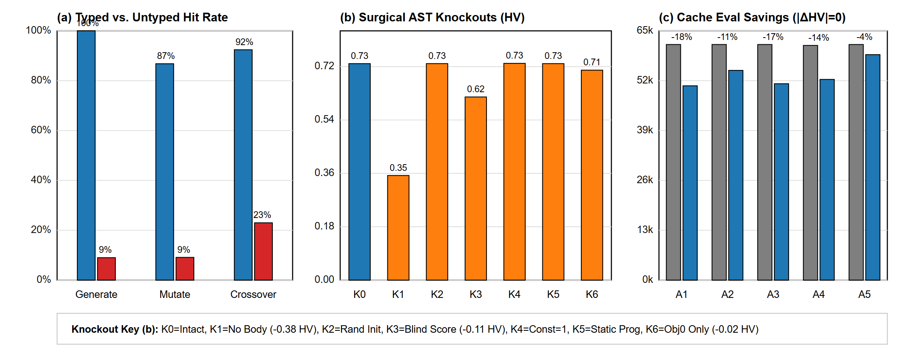

# Evolution of Multi-Objective Optimization Hyper-Heuristics via Genetic Programming with Typed S-Expressions in Clojure

**Nikolay Penchev**$^{1}$, **Angel Marchev, Jr.**$^{2}$  
e-mail: nikolay.penchev@ctr.ibusinessfunding.com$^{1}$, e-mail: angel.marchev@unwe.bg$^{2}$

---

## Abstract

This study investigates multi-objective optimization hyper-heuristics built from typed symbolic expressions (typed S-expressions) through Genetic Programming in Clojure. Rather than parameterizing a fixed metaheuristic, the proposed system evolves complete executable search algorithms encoded as quoted list trees validated by static role and effect rules and executed by a bounded interpreter. Across 30 independent runs on non-overlapping NASDAQ-50 equity portfolio windows (2012–2026, selecting 5 from 50 assets) and 40-job single-machine scheduling benchmarks, we compare mixed Genetic Programming, mutation-only Genetic Programming, equal-budget random grammar search, fixed-template formula evolution, and configured Non-dominated Sorting Genetic Algorithm II, Pareto Local Search, and Multi-Start Restart baselines under a 256-evaluation budget. On scheduling, evolved algorithms achieve a mean normalized hypervolume of 0.53974 (597.5 milliseconds per instance), outperforming conventional baselines (0.52751, 632.8 milliseconds) in 28 of 30 runs while lowering compromise completion time and total tardiness. On portfolio selection, evolved programs execute 22% faster (127.7 versus 164.6 milliseconds), yield a higher return-to-risk ratio (4.33 versus 4.24), and match conventional hypervolume (0.72975 versus 0.73440) within a 0.01 equivalence margin. Ablations confirm that budget-aware initialization (+0.02110 to +0.02316) and static role typing drive search quality.

**Key words:** Genetic Programming, Typed S-Expressions, Clojure, Multi-Objective Optimization, Hyper-Heuristics  
**JEL:** C61, C63, G11

---

## Introduction

Automated algorithm design shifts heuristic engineering from manual trial-and-error to systematic program synthesis. Conventional metaheuristics fix the search structure (initialization, moves, and acceptance), leaving only numerical tuning or solution encoding to search. When domain structure changes or conflicting objectives trade off, rigid templates degrade. In earlier studies, we compared discrete portfolio evolution against exact dynamic programming (Penchev & Marchev, 2026b) and evolved single-objective knapsack optimizers via typed symbolic expressions (Penchev & Marchev, 2026a), demonstrating strong combinatorial performance and interpretable tree code.

However, our prior typed S-expression study (Penchev & Marchev, 2026a) had key limitations: asset costs were independent, a preset `return-per-cost` heuristic supplied most quality, subtree crossover was absent, and no equal-budget random grammar control existed. Four research questions follow: (1) Can typed S-expression evolution synthesize multi-objective hyper-heuristics without preset greedy rules? (2) Does one shared framework generalize across historical equities and scheduling? (3) What value do crossover and selection add beyond random grammar search and formula-only evolution? (4) How do evolved programs compare with tuned conventional optimizers in hypervolume, speed, and domain quality?

To answer these questions, we evaluate homoiconic Clojure Genetic Programming across 30 seeds on NASDAQ-50 equities (`2012-01-03`–`2026-02-27`) and J. E. Beasley's OR-Library `wt40` scheduling suite (Beasley, 1990). Every synthesized program terminates safely and remains compact (18.7–19.2 nodes). On `wt40`, mixed GP beats conventional baselines by `+0.01222` normalized hypervolume (`0.53974` vs. `0.52751`, *p* < 0.0001, 28/30 seeds) and dominates the knee schedule. On NASDAQ-50, evolved programs run 22% faster (`127.7 ms` vs. `164.6 ms`), raise return-to-risk ratio (`4.33` vs. `4.24`), and match conventional baselines (`0.72975` vs. `0.73440`) within a `0.01` equivalence margin.

---

## Theoretical Aspects

### Lisp, Clojure, and Homoiconicity

Representing algorithms as symbolic data trees traces to McCarthy's (1960) Lisp formalism of symbolic expressions (S-expressions) and meta-circular evaluation (`eval`). Clojure (Hickey, 2008) brings Lisp to the Java Virtual Machine via immutable persistent lists `(...)`, vectors `[...]`, maps `{...}`, and keywords (`:keyword`), so modifying any tree node never mutates parent programs across generations. Because Lisp syntax is isomorphic to its abstract syntax tree (*homoiconicity*), quoting a Clojure list as `'(:add (:feature :objective-0) (:multiply (:feature :progress) (:feature :objective-1)))` treats executable logic directly as data. Figure 1 illustrates this exact one-to-one mapping between a quoted portfolio S-expression and its six-role AST, enabling variation without parsing or runtime compilation.

  
Source: Authors' own elaboration based on the implemented typed S-expression domain-specific language.  
Figure 1: Homoiconic correspondence between a quoted Clojure S-expression optimizer and its six-role typed abstract syntax tree

### Genetic Programming, Typed Grammars, and Hyper-Heuristics

Koza (1992) established tree-based Genetic Programming (GP) over Lisp S-expressions under syntactic closure. For multi-stage optimization algorithms mixing loop counts, conditionals, moves, and scalarizations, untyped variation breaks structural validity; Montana's (1995) Strongly Typed GP and grammar-guided GP (Ryan et al., 1998; McKay et al., 2010) enforce legal subtrees by construction. Recent studies demonstrate how higher-order types (`HOTGP`; Fernandes et al., 2023), initialization priors vs. random grammar search (Dick & Whigham, 2022), iterative numerical solver synthesis (Parthasarathy et al., 2024), and semantics-aware variation operators (Wyrwiński & Krawiec, 2025) shape search efficacy.

Hyper-heuristics automate algorithm construction rather than problem-space tuning (Burke et al., 2013), spanning linear GP algorithm synthesis (Oltean, 2005), modular MOEA design (`AutoMOEA`; Bezerra et al., 2016), and formal program synthesis (Gulwani et al., 2017). Recent advances include multi-objective workflow GP hyper-heuristics (Zaki et al., 2024; Sun et al., 2024), sparse/distributionally robust exact-*K* portfolio optimization (Kobayashi et al., 2023; Lapucci & Mansueto, 2024), and LLM-assisted evolutionary search (`FunSearch`, Romera-Paredes et al., 2024; `EoH`, Liu et al., 2024). Table 1 maps these streams to the present work.

Table 1: Main literature streams, recent advances, and positioning of the present study

| Stream | Key Sources | Main Idea and Recent Advances | Role in the Present Research |
| :--- | :--- | :--- | :--- |
| Lisp, Clojure, Homoiconicity | McCarthy (1960); Hickey (2008) | Code and tree data share `'(:op ...)` lists; Clojure adds persistent structures. | Optimizers are immutable S-expressions validated and executed without compilation. |
| GP & Adaptive Operators | Koza (1992); Wyrwiński & Krawiec (2025) | Tree crossover/mutation; recent learned semantics-aware variation operators. | Drives the outer evolutionary loop (`:gp-mixed` vs. `:gp-mutation-only`). |
| Typed & Grammar-Guided GP | Montana (1995); Ryan et al. (1998); McKay et al. (2010); Dick & Whigham (2022); Fernandes et al. (2023) | Role/grammar constraints enforce valid subtrees; recent focus on prior bias and higher-order types. | Enforces six roles and static effects while ablating `v1`/`v2` priors and untyped edits. |
| Hyper-Heuristics | Oltean (2005); Burke et al. (2013); Bezerra et al. (2016); Zaki et al. (2024); Sun et al. (2024) | Evolves dispatching rules or modular MOEAs for scheduling and combinatorial optimization. | Co-evolves multi-stage control flow and dynamic bi-objective scores in one AST. |
| Synthesis & LLM-EC | Gulwani et al. (2017); Parthasarathy et al. (2024); Romera-Paredes et al. (2024); Liu et al. (2024) | Synthesizes multigrid solvers via G3P or pairs LLMs with evolutionary evaluators. | Replaces opaque LLMs with an auditable deterministic grammar and random-DSL controls. |
| Sparse Portfolios & Prior Work | Kobayashi et al. (2023); Lapucci & Mansueto (2024); Penchev & Marchev (2026a, 2026b) | Exact-*K* robust/sparse portfolios and 1-objective knapsack S-expressions. | Drops greedy presets and tests bi-objective NASDAQ-50 and OR-Library `wt40`. |
| **Present Study** | **Current manuscript (2026)** | **Six-role Clojure S-expressions co-evolving control flow and scalarizations across NASDAQ-50 and `wt40`.** | **Isolates `v2` prior, role typing, H1–H4 controls, runtime, and AST ablations.** |

Source: Authors' own synthesis based on the cited literature.

### Research Gap Addressed

Four gaps motivate this study. First, multi-objective scheduling GP hyper-heuristics (Zaki et al., 2024; Sun et al., 2024) evolve priority rules inside fixed simulators, and modular MOEA tools (Bezerra et al., 2016) tune fixed templates; neither co-evolves complete control flow and scalarization across both finance and scheduling. Second, LLM-evolutionary systems (Romera-Paredes et al., 2024; Liu et al., 2024) conflate pretrained priors with evolutionary discovery, underscoring Dick and Whigham's (2022) call for equal-budget random-grammar baselines. Third, recent cardinality-constrained portfolio methods (Kobayashi et al., 2023; Lapucci & Mansueto, 2024) build domain-specific mathematical solvers rather than transferable symbolic trees. Fourth, our earlier knapsack study (Penchev & Marchev, 2026a) relied on a preset greedy initializer and omitted crossover and random-DSL controls. We close this gap under strict equal-budget accounting on frozen public benchmarks.

---

## Methods

### Six-Role Typed DSL, Static Effects, and Bounded Interpreter

We construct a binder-free, statically typed Clojure DSL with root form `'(:program <domain> (:budget <operation>))`. Every AST node belongs to one of six disjoint roles: `:operation` (`:noop`, `:seq`, `:repeat`, `:if`, `:initialize`, `:step`, `:search`), `:count` ($\in \{2, 4, 8, 12, 16, 24, 32, 64\}$), `:initializer` (`:random`, `:first`), `:operator`, `:predicate` (`:not`, `:and`, `:less`, `:archive-changed`, `:budget-left`, `:coin`), and `:score` (combining `:objective-0`, `:objective-1`, `:progress`, constants, `:add`, and `:multiply`). Without free variables, exchanging same-role subtrees guarantees syntactic validity. Static checks further enforce effect permissions (`:pure`, `:control`, `:state`) and structural limits (max 128 nodes, depth 12, count 256), summarized in Figure 2.

  
Source: Authors' own elaboration based on the implemented Clojure architecture.  
Figure 2: Architecture of the typed S-expression optimizer framework showing (a) six-role DSL, (b) meta-evolution and bounded interpreter, and (c, d) benchmark adapters

A bounded interpreter enforces an interpreter step cap and a strict per-instance budget of $B = 256$ candidate proposals. When the optional evaluation cache (`cache? = true`) reuses objective vectors on revisited solutions, cache hits still count as 1 proposal against $B = 256$, guaranteeing bitwise-identical Pareto archives. To test initialization priors (Dick & Whigham, 2022), we compare a uniform baseline (`development-only-v1`, where shallow top-level branches halt early) against `budget-aware-v2`, which aligns `:seq`, `:repeat`, and `:search` blocks with the 256-proposal ceiling.

### Benchmark Formulations and Normalized Hypervolume

Each benchmark uses 36 frozen instances split into 6 training, 6 validation, and 24 held-out test instances. **Exact-K Portfolio Selection on NASDAQ-50 (`:portfolio`)** uses historical daily returns of 50 NASDAQ equities (`2012-01-03`–`2026-02-27`, 3,558 trading-day vectors) across 36 non-overlapping $T = 90$-day windows with 8-day embargo gaps (6 train `2012–2014`, 6 validation `2014–2016`, 24 test `2016–2025`). Using `DECIMAL128` arithmetic, each equal-weight portfolio chooses $K = 5$ assets minimizing negative mean daily return and daily return sample standard deviation:

$$\min_{x \in \{0,1\}^N} \left( f_1(x) = -\bar{R}_p(x),\; f_2(x) = s_p(x) \right), \quad \text{s.t. } \sum_{i=1}^{N} x_i = K \qquad (1)$$

Domain moves preserve cardinality via `:swap` and `:restart`, with `:first` and `:random` initializers. **Bi-Objective Single-Machine Scheduling on OR-Library `wt40` (`:scheduling`)** (Beasley, 1990) selects 36 stratified 40-job instances ($J = 40$; $\text{RDD}, \text{TF} \in \{0.2, \dots, 1.0\}$). Each job permutation $\pi \in \mathfrak{S}_J$ minimizes mean completion time and total tardiness:

$$\min_{\pi \in \mathfrak{S}_J} \left( f_1(\pi) = \frac{1}{J}\sum_{j=1}^{J} C_{\pi(j)},\; f_2(\pi) = \sum_{j=1}^{J} \max\left(0, C_{\pi(j)} - d_{\pi(j)}\right) \right) \qquad (2)$$

Scheduling moves include `:insert`, `:swap`, `:reverse`, `:restart`, and Shortest Processing Time (`:first`). Performance is measured by normalized 2D hypervolume over fixed instance bounds mapped into $[0,1]^2$ with reference $r = (1.05, 1.05)$ (divisor $1.1025$):

$$\mathrm{HV}_{\mathrm{norm}}(\mathcal{P}) = \frac{1}{1.1025} \sum_{m=1}^{|\mathcal{P}'|} \left(1.05 - z_1^{(m)}\right)\left(z_2^{(m-1)} - z_2^{(m)}\right), \quad z_2^{(0)} = 1.05 \qquad (3)$$

Figure 3 shows representative discrete Pareto fronts as orthogonal hypervolume staircases with monotone trade-off curves.

  
Source: Authors' own experimental runs on frozen benchmark instances.  
Figure 3: Representative non-dominated Pareto fronts on real NASDAQ portfolio selection ($N=15, K=5, T=90$) and OR-Library `wt40` scheduling ($J=40$ jobs)

### Experimental Protocol, Ethics, and Reproducibility Statement

Across 30 outer seeds (`0..29`), each search arm receives 256 outer program assessments per seed (selecting one top validation program for single-shot held-out testing; Table 2). We compare Full GP (`A1: :gp-mixed`), Mutation-Only GP (`A2: :gp-mutation-only`), Equal-Budget Random DSL (`A3: :random-dsl`), Formula-Only Evolution (`A4: :formula-only`), and Configured Conventional Baselines (`A5: :configured-conventional`, validation-tuned across NSGA-II, Pareto Local Search, and Multi-Start Restart). Four paired hypotheses (**H1**: `A1` vs. `A3`; **H2**: `A1` vs. `A4`; **H3**: `A1` vs. `A2`; **H4**: `A1` vs. `A5`) use 10,000-resample paired bootstrap confidence intervals, Holm-Bonferroni correction ($\alpha = 0.05$), and $\Delta_{\mathrm{prac}} = 0.01$. All Clojure source code, test suites, configuration files, and the deterministic NASDAQ-50 data reconstruction script are publicly archived at https://github.com/npenchev88/typed-sexpr-hyperheuristics.

**Ethics Approval and Originality Statement.** This study uses only public historical equity series (NASDAQ-50) and the public OR-Library `wt40` benchmark; no human subjects, personal data, or animal experiments are involved, so ethics board approval is not applicable. All work is original, properly cited under APA 7th guidelines, free of plagiarism or unverified AI fabrication, and not submitted elsewhere.

Table 2: Main experimental parameters across both benchmark domains

| Parameter | NASDAQ-50 Portfolio (`:portfolio`) | OR-Library `wt40` Scheduling (`:scheduling`) |
| :--- | :--- | :--- |
| Source & Representation | Daily returns (`2012-01-03`–`2026-02-27`), $N=50, K=5, T=90$ | Beasley `wt40` (`J = 40` jobs), stratified RDD/TF |
| Splits & Budgets | 6 train / 6 val / 24 test; 30 seeds × 256 outer × 256 base | 6 train / 6 val / 24 test; 30 seeds × 256 outer × 256 base |
| AST & Stats | Max 128 nodes, depth 12; bootstrap (10,000), Holm ($\alpha=0.05$) | Max 128 nodes, depth 12; bootstrap (10,000), Holm ($\alpha=0.05$) |

Source: Authors' experimental design.

---

## Results and Discussion

### Five-Arm Performance and Computational Speed Across 30 Seeds

Table 3 and Figure 4 report 30-seed test hypervolume, front size ($\|ND\|$), per-instance runtime, outer design time, candidate diversity, and program size. All typed DSL runs (`A1`–`A3`) executed without errors, yielding 30/30 unique trees (14.1–19.2 nodes). Evolved `:gp-mixed` programs run 22% faster per portfolio window than `:configured-conventional` (`127.7 ms` vs. `164.6 ms`) by avoiding generational non-dominated sorting overhead, and finish in `597.5 ms` vs. `632.8 ms` on `wt40`. Outer design times (`1056.3 s` and `1954.9 s`) are likewise shorter than conventional grid tuning (`1499.1 s` and `2326.8 s`).

Table 3: Thirty-seed test hypervolume, runtime, and structural summary (`budget-aware-v2` prior)

| Domain and Arm | Test HV (Mean ± SD) | Median (Min–Max) | Val. HV | $\|ND\|$ | Run (ms) | Design (s) | Distinct | Nodes | Unique |
| :--- | :---: | :---: | :---: | :---: | :---: | :---: | :---: | :---: | :---: |
| **NASDAQ-50 Portfolio** | | | | | | | | | |
| `A1: :gp-mixed` (`v2`) | $0.72975 \pm 0.00768$ | $0.73163$ (0.7118–0.7414) | $0.75509$ | $14.9$ | $127.7$ | $1056.3 \pm 211.6$ | $243.9$ | $18.9$ | $30/30$ |
| `A2: :gp-mutation-only` | $0.72974 \pm 0.01263$ | $0.73286$ (0.6738–0.7473) | $0.75449$ | $14.8$ | $137.2$ | $1061.1 \pm 192.8$ | $251.5$ | $19.2$ | $30/30$ |
| `A3: :random-dsl` (`v2`) | $0.72785 \pm 0.00822$ | $0.72656$ (0.7118–0.7385) | $0.75474$ | $14.8$ | **$125.7$** | **$688.4 \pm 95.5$** | $250.9$ | $14.2$ | $30/30$ |
| `A4: :formula-only` (`v2`) | **$0.73587 \pm 0.00241$** | **$0.73646$** (0.7265–0.7374) | $0.75724$ | $15.6$ | $128.7$ | $1316.2 \pm 164.8$ | $162.4$ | $13.7$ | $9/30$ |
| `A5: :configured-conv.` | $0.73440 \pm 0.00241$ | $0.73423$ (0.7322–0.7409) | **$0.76167$** | **$16.9$** | $164.6$ | $1499.1 \pm 192.7$ | $150.1$ | $6.4$ | 18 NSGA-II, 12 PLS |
| **OR-Library `wt40`** | | | | | | | | | |
| `A1: :gp-mixed` (`v2`) | **$0.53974 \pm 0.00438$** | **$0.54164$** (0.5227–0.5433) | **$0.55240$** | $4.4$ | $597.5$ | $1954.9 \pm 289.2$ | $244.0$ | $18.7$ | $30/30$ |
| `A2: :gp-mutation-only` | $0.53933 \pm 0.00403$ | $0.54145$ (0.5259–0.5425) | $0.55182$ | $4.4$ | **$589.7$** | $1970.4 \pm 267.5$ | $253.0$ | $18.2$ | $30/30$ |
| `A3: :random-dsl` (`v2`) | $0.53970 \pm 0.00472$ | $0.54155$ (0.5235–0.5425) | $0.55109$ | $4.5$ | $643.7$ | **$1562.0 \pm 182.9$** | $252.9$ | $14.1$ | $30/30$ |
| `A4: :formula-only` (`v2`) | $0.53829 \pm 0.00054$ | $0.53838$ (0.5374–0.5391) | $0.54650$ | $3.7$ | $649.3$ | $2213.3 \pm 394.1$ | $160.9$ | $14.8$ | $19/30$ |
| `A5: :configured-conv.` | $0.52751 \pm 0.00212$ | $0.52786$ (0.5237–0.5301) | $0.54321$ | **$7.4$** | $632.8$ | $2326.8 \pm 408.3$ | $190.1$ | $6.4$ | 19 NSGA-II, 11 PLS |

Source: Authors' 30-seed experiments on NASDAQ-50 equities and OR-Library wt40 (bold marks best per column).

On `wt40`, `:gp-mixed` (`0.53974`) beats `:configured-conventional` (`0.52751`) by `+0.01222` HV across 28/30 seeds and exceeds `:formula-only` (`0.53829`). On NASDAQ-50, `:gp-mixed` outperforms `:configured-conventional` in 12/30 seeds (`0.72975` vs. `0.73440`), staying inside the `±0.01` equivalence band.

  
Source: Authors' 30-seed confirmatory and prior-ablation runs.  
Figure 4: Test normalized hypervolume across the five search arms and comparison of `budget-aware-v2` versus `development-only-v1` priors

### Domain-Level Quality and Concrete Solutions

Table 4 converts Pareto fronts into concrete domain metrics across the 24 held-out test instances. On NASDAQ-50, all four DSL arms achieve higher peak returns (`+0.378%` to `+0.380%`) and return-to-risk ratios (`4.33`–`4.43`) than `:configured-conventional` (`+0.371%`, `4.24`), whereas NSGA-II/PLS captures extra low-volatility corner points (`0.845%` vs. `0.947%`). On test window `nasdaq-test-23` (late `2025`), median `:gp-mixed` produces 14 portfolios spanning defensive `(AAPL, COST, CTSH, IDXX, PEP)` (`11.99%` annualized volatility), balanced `(ASML, CTSH, GILD, MAR, MU)` (`+0.422%` daily return, `4.94` return-to-risk), and growth `(GOOGL, INTC, KLAC, LRCX, MU)` (`+0.686%` daily return). On `wt40`, SPT and EDD leave high tardiness (`11,173.8` and `12,032.6`), whereas `:gp-mixed` lowers minimum tardiness to `9,878.3` and strictly dominates `:configured-conventional` at the knee schedule (`781.9 / 9,928.8` vs. `828.7 / 10,410.1`).

Table 4: Concrete domain-level solution quality averaged across 24 held-out test instances (Mean ± 95% CI)

| Benchmark and Method | Extreme Objective 1 | Extreme Objective 2 | Compromise / Knee Quality | $\|ND\|$ |
| :--- | :---: | :---: | :---: | :---: |
| **NASDAQ-50 Portfolio** | **Max Daily Ret. (Ann. %)** | **Min Daily Risk (Ann. %)** | **Max Ann. Ret./Risk** | **Size** |
| `A1: :gp-mixed` (`v2`) | +0.379% (+95.53 ± 1.29%) | 0.947% (15.04 ± 0.28%) | 4.33 ± 0.05 | 14.9 |
| `A2: :gp-mutation-only` | +0.378% (+95.29 ± 1.25%) | 0.952% (15.11 ± 0.29%) | 4.37 ± 0.05 | 14.9 |
| `A3: :random-dsl` (`v2`) | **+0.380% (+95.87 ± 1.26%)** | 0.962% (15.27 ± 0.33%) | 4.33 ± 0.05 | 14.9 |
| `A4: :formula-only` (`v2`) | +0.379% (+95.44 ± 0.63%) | 0.935% (14.84 ± 0.26%) | **4.43 ± 0.02** | 15.9 |
| `A5: :configured-conv.` | +0.371% (+93.49 ± 0.41%) | **0.845% (13.42 ± 0.23%)** | 4.24 ± 0.04 | **17.2** |
| **OR-Library `wt40`** | **Min Completion ($f_1$)** | **Min Tardiness ($f_2$)** | **Knee ($f_1$ / $f_2$)** | **Size** |
| Classical SPT | **734.5** | 11,173.8 | 734.5 / 11,173.8 | 1.0 |
| Classical EDD | 1,037.8 | 12,032.6 | 1,037.8 / 12,032.6 | 1.0 |
| `A1: :gp-mixed` (`v2`) | **775.2 ± 3.6** | 9,878.3 ± 124.1 | **781.9 / 9,928.8** | 4.4 |
| `A2: :gp-mutation-only` | 779.7 ± 4.0 | 9,880.2 ± 101.5 | 786.9 / 9,934.9 | 4.4 |
| `A3: :random-dsl` (`v2`) | 777.6 ± 4.6 | **9,847.3 ± 149.1** | 784.6 / 9,895.1 | 4.5 |
| `A4: :formula-only` (`v2`) | 779.6 ± 2.6 | 9,903.2 ± 71.2 | 785.8 / 9,957.0 | 3.7 |
| `A5: :configured-conv.` | 794.9 ± 2.0 | 10,173.7 ± 49.3 | 828.7 / 10,410.1 | **7.4** |

Source: Authors' held-out test evaluations on 2016-2025 NASDAQ-50 quarters and OR-Library wt40 (bold marks best per column).

### Hypothesis Tests and Prior Ablation

Table 5 details the paired bootstrap hypothesis contrasts. Both **H1** (`:gp-mixed` vs. `:random-dsl`) and **H3** (`:gp-mixed` vs. `:gp-mutation-only`) show small positive point estimates with confidence intervals wholly inside `[-0.01, +0.01]`, indicating practical equivalence under a 256-assessment outer budget once initialized from `v2`. For **H4**, `:gp-mixed` is practically equivalent to `:configured-conventional` on portfolios (`-0.00465`) and significantly superior on `wt40` scheduling (`+0.01222`, Holm *p* < 0.0001). Most strikingly, replacing `development-only-v1` with `budget-aware-v2` boosts `:gp-mixed` HV by `+0.02110` on NASDAQ-50 and `+0.02316` on `wt40` (*p* < 0.0001), confirming Dick and Whigham's (2022) insight that grammar initialization alignment critically governs generative GP performance.

Table 5: Paired bootstrap contrasts across 30 seeds (10,000 resamples, $\Delta_{\mathrm{prac}} = 0.01$)

| Contrast | NASDAQ-50 Diff (Simult. 95% CI) | Portfolio Holm *p* & Verdict | `wt40` Diff (Simult. 95% CI) | Scheduling Holm *p* & Verdict |
| :--- | :---: | :---: | :---: | :---: |
| **H1:** `A1` vs. `A3` | $+0.00190$ ($[-0.00215, +0.00599]$) | *p* = 0.4776 · Pract. equivalent | $+0.00003$ ($[-0.00300, +0.00318]$) | *p* = 1.0000 · Pract. equivalent |
| **H2:** `A1` vs. `A4` | $-0.00612$ ($[-0.01002, -0.00255]$) | *p* = 0.0008 · Inconclusive* | $+0.00144$ ($[-0.00085, +0.00311]$) | *p* = 0.2538 · Pract. equivalent |
| **H3:** `A1` vs. `A2` | $+0.00001$ ($[-0.00570, +0.00754]$) | *p* = 0.9318 · Pract. equivalent | $+0.00040$ ($[-0.00197, +0.00265]$) | *p* = 1.0000 · Pract. equivalent |
| **H4:** `A1` vs. `A5` | $-0.00465$ ($[-0.00846, -0.00111]$) | *p* = 0.0060 · Pract. equivalent | **$+0.01222$** ($[+0.00937, +0.01425]$) | *p* < 0.0001 · Superior* |
| **Prior:** `v2` vs. `v1` | **$+0.02110$** ($[+0.01392, +0.02848]$) | *p* < 0.0001 · Pract. superior | **$+0.02316$** ($[+0.01637, +0.03060]$) | *p* < 0.0001 · Pract. superior |

Source: Authors' paired bootstrap analysis (*Note:* Scheduling H4 unadjusted 95% CI is $[+0.01022, +0.01390]$; Portfolio H2 unadjusted 95% CI is $[-0.00915, -0.00324]$).

### Anytime Budget Scaling and Mechanism Ablations

Across intermediate evaluation budgets $B \in \{16, 32, 64, 128, 256\}$ (Figure 5), `:gp-mixed` demonstrates strong anytime convergence. On NASDAQ-50 portfolios, `:gp-mixed` leads `:configured-conventional` across every intermediate budget from $B=16$ through $B=128$ (e.g., `0.66832` vs. `0.64250` at $B=64$, and `0.70545` vs. `0.69347` at $B=128$) before NSGA-II/PLS catches up at $B=256$. On `wt40`, `:gp-mixed` overtakes `:configured-conventional` by $B=64$ (`0.46570` vs. `0.45707`) and widens its margin to `0.54067` vs. `0.52760` at $B=256$.

  
Source: Authors' budget-scaling ablation runs across 30 seeds.  
Figure 5: Anytime normalized test hypervolume scaling across per-instance evaluation budgets $B \in \{16, 32, 64, 128, 256\}$

Mechanism ablations (Figure 6) verify three drivers: (1) **Static Typing (Panel A)** gives 100% valid `v2` trees (`0` rejections) and 86.8%–93.5% edit hit rates, whereas untyped variation (`:untyped-validated`) rejects ~91% of proposals (`6,199` rejections for `613` valid trees), collapsing HV to `0.36461` (portfolios) and `0.35601` (`wt40`); (2) **AST Knockouts (Panel B)** show deleting the search body (`K1`) drops HV by `-0.37724` (portfolios) and `-0.18466` (`wt40`), and zeroing `:score` (`K3`) drops HV by `-0.11241` and `-0.11874`, proving downstream search loops drive quality; and (3) **Cache Accounting (Panel C)** confirms `cache? = true` yields bitwise-identical archives (`max-hv-abs-diff = 0.0`), skips 17.5% of NASDAQ-50 objective evaluations (`147.0` to `127.7 ms`), and prevents `+0.00163`–`+0.00256` inflation.

  
Source: Authors' mechanism ablation experiments on frozen benchmarks.  
Figure 6: Mechanism ablations comparing (a) typed vs. untyped hit rates, (b) AST knockouts `K0`–`K6`, and (c) cache evaluation savings

### Meta-Evolution Dynamics and Evolved Program Inspection

Across the 8 outer assessment batches (`B0`–`B7`, Figure 7), `:gp-mixed` steadily improves training HV (`+0.03113` on portfolios from `0.73891` to `0.77005`; `+0.03067` on `wt40` from `0.52131` to `0.55198`). Crucially, GP discovers domain-matched neighborhood structures automatically: all 30 final portfolio programs select `:swap` (with 12 adding `:restart`), whereas 26 of 30 final scheduling programs discover `:insert` alongside 9 adopting SPT (`:first`) initialization.

  
Source: Authors' 30-seed meta-evolution logs and AST tallies.  
Figure 7: Outer meta-evolution training trajectories (a) and structural operator/feature frequencies across the 30 final `:gp-mixed` programs (b)

Homoiconicity renders the discovered algorithms transparently readable. On NASDAQ-50, the median `:gp-mixed` program (Seed 28, test HV `0.73259`, 19 nodes) runs 32 `:restart` exploration steps before 24 repetitions of 24-proposal `:swap` local search guided by a progress-annealed scalarization $\mathrm{objective}_0 + \mathrm{progress}\cdot \mathrm{objective}_1$:

```clojure
'(:program :portfolio
  (:budget
    (:seq
      (:search (:count 32) (:operator :restart)
        (:add (:feature :objective-0) (:constant -2.0)))
      (:repeat (:count 24)
        (:search (:count 24)
          (:operator :swap)
          (:add (:feature :objective-0)
            (:multiply (:feature :progress) (:feature :objective-1))))))))
```

On `wt40` scheduling, the median `:gp-mixed` program (Seed 21, test HV `0.54164`, 17 nodes) discovers the exact same annealing formula paired with nested `:insert` local search, whereas the best Seed 0 program (test HV `0.54334`, 35 nodes) pairs SPT (`:first`) initialization with `:swap` and `:insert` phases. Critically, these empirical findings remain bounded by two design limits: under a 256-program outer budget and strong `v2` prior, full GP shows only a minor edge (`+0.00190`) over equal-budget random DSL sampling (**H1**), and trajectory-based DSL primitives produce slightly narrower portfolio fronts (`14.9` vs. `16.9` points) than population-based NSGA-II.

---

## Conclusion

Addressing our four research questions, homoiconic six-role typed S-expressions in Clojure synthesize compact, error-free, interpretable multi-objective hyper-heuristics without preset greedy rules or opaque LLM priors. Across 30 runs on NASDAQ-50 (`2016–2025`) and OR-Library `wt40`, evolved programs run 22% faster on portfolios (`127.7 ms` vs. `164.6 ms`) while matching NSGA-II/PLS hypervolume (`0.72975` vs. `0.73440`) with superior return-to-risk ratios (`4.33` vs. `4.24`), and significantly outperform conventional baselines on `wt40` scheduling (`+0.01222` HV, *p* < 0.0001, 28/30 seeds) while dominating the knee schedule. Static role typing prevents combinatorial collapse, and budget-aware grammar initialization (`v2` vs. `v1`) drives decisive gains (`+0.02110` to `+0.02316`), explaining why random `v2` sampling performs competitively at 256 outer assessments. Future work should add population-level crossover and crowding-distance archive operators, scale outer GP budgets, and include portfolio transaction costs.

---

## Notes

Author academic affiliations and ORCID identifiers appear in Footnotes 1 and 2 on page 1; repository access and data provenance notes appear in Footnote 3.

1. *Faculty of Economics and Business Administration, Sofia University "St. Kliment Ohridski", Sofia, Bulgaria, ORCID: 0009-0000-8955-2474.*
2. *Department of Management, University of National and World Economy (UNWE), and Faculty of Economics and Business Administration, Sofia University "St. Kliment Ohridski", Sofia, Bulgaria, ORCID: 0000-0002-5090-3123.*
3. *Source code, experiment configurations, 30-seed replication logs, and the Yahoo Finance NASDAQ-50 dataset reconstruction script are available at https://github.com/npenchev88/typed-sexpr-hyperheuristics alongside the public OR-Library wt40 benchmark.*

---

## Acknowledgements

This work was financially supported by the UNWE Research Project NID NI-11/2026/A.

---

## References

Beasley, J. E. (1990). OR-Library: Distributing test problems by electronic mail. *Journal of the Operational Research Society*, *41*(11), 1069–1072. https://doi.org/10.1057/jors.1990.166

Bezerra, L. C. T., López-Ibáñez, M., & Stützle, T. (2016). Automatic component-wise design of multiobjective evolutionary algorithms. *IEEE Transactions on Evolutionary Computation*, *20*(3), 403–417. https://doi.org/10.1109/TEVC.2015.2474158

Burke, E. K., Gendreau, M., Hyde, M., Kendall, G., Ochoa, G., Özcan, E., & Qu, R. (2013). Hyper-heuristics: A survey of the state of the art. *Journal of the Operational Research Society*, *64*(12), 1695–1724. https://doi.org/10.1057/jors.2013.71

Dick, G., & Whigham, P. A. (2022). Initialisation and grammar design in grammar-guided evolutionary computation. *arXiv*. https://arxiv.org/abs/2204.07410

Fernandes, M. C., de França, F. O., & Francesquini, E. (2023). HOTGP: Higher-order typed genetic programming. In *Proceedings of the Genetic and Evolutionary Computation Conference (GECCO '23)*. ACM. https://doi.org/10.1145/3583131.3590464

Gulwani, S., Polozov, O., & Singh, R. (2017). Program synthesis. *Foundations and Trends in Programming Languages*, *4*(1–2), 1–119. https://doi.org/10.1561/2500000010

Hickey, R. (2008). The Clojure programming language. In *Proceedings of the 2008 Symposium on Dynamic Languages (DLS '08)* (pp. 1–12). ACM. https://doi.org/10.1145/1408681.1408682

Kobayashi, K., Takano, Y., & Nakata, K. (2023). Cardinality-constrained distributionally robust portfolio optimization. *European Journal of Operational Research*. https://doi.org/10.1016/j.ejor.2023.01.037

Koza, J. R. (1992). *Genetic programming: On the programming of computers by means of natural selection*. MIT Press.

Lapucci, M., & Mansueto, P. (2024). Cardinality-constrained multi-objective optimization: Novel optimality conditions and algorithms. *Journal of Optimization Theory and Applications*. https://doi.org/10.1007/s10957-024-02397-3

Liu, F., Tong, X., Yuan, M., Lin, X., Luo, F., Wang, Z., Lu, Z., & Zhang, Q. (2024). Evolution of heuristics: Towards efficient automatic algorithm design using large language model. In *Proceedings of the International Conference on Machine Learning (ICML 2024)*.

McCarthy, J. (1960). Recursive functions of symbolic expressions and their computation by machine, part I. *Communications of the ACM*, *3*(4), 184–195. https://doi.org/10.1145/367177.367199

McKay, R. I., Hoai, N. X., Whigham, P. A., Shan, Y., & O'Neill, M. (2010). Grammar-based genetic programming: A survey. *Genetic Programming and Evolvable Machines*, *11*, 365–396. https://doi.org/10.1007/s10710-010-9109-y

Montana, D. J. (1995). Strongly typed genetic programming. *Evolutionary Computation*, *3*(2), 199–230. https://doi.org/10.1162/evco.1995.3.2.199

Oltean, M. (2005). Evolving evolutionary algorithms using linear genetic programming. *Evolutionary Computation*, *13*(3), 387–410. https://doi.org/10.1162/1063656054794815

Parthasarathy, D., Mitchell, W. B., & Köstler, H. (2024). Evolving algebraic multigrid methods using grammar-guided genetic programming. *arXiv*. https://arxiv.org/abs/2412.05852

Penchev, N., & Marchev, A., Jr. (2026a). Evolution of interpretable optimization algorithms through typed S-expressions for binary knapsack-like portfolio selection. In *Artificial Intelligence: Methodology, Systems, and Applications (AIMSA)*.

Penchev, N., & Marchev, A., Jr. (2026b). Multi-objective knapsack-like portfolio optimization using evolutionary algorithm (UNWE Research Project No. NID NI-11/2026/A). University of National and World Economy.

Romera-Paredes, B., Barekatain, M., Novikov, A., Balog, M., Kumar, M. P., Dupont, E., Ruiz, F. J. R., Ellenberg, J. S., Wang, P., Fawzi, O., Kohli, P., & Fawzi, A. (2024). Mathematical discoveries from program search with large language models. *Nature*, *625*, 468–475. https://doi.org/10.1038/s41586-023-06924-6

Ryan, C., Collins, J. J., & O'Neill, M. (1998). Grammatical evolution: Evolving programs for an arbitrary language. In *Genetic Programming: First European Workshop, EuroGP'98* (pp. 83–96). Springer. https://doi.org/10.1007/BFb0055930

Sun, Z., Mei, Y., Zhang, F., Huang, H., Gu, C., & Zhang, M. (2024). Multi-tree genetic programming hyper-heuristic for dynamic flexible workflow scheduling in multi-clouds. *IEEE Transactions on Services Computing*. https://doi.org/10.1109/TSC.2024.3394691

Wyrwiński, P., & Krawiec, K. (2025). Learning semantics-aware search operators for genetic programming. In *Proceedings of the Genetic and Evolutionary Computation Conference Companion (GECCO '25 Companion)*. ACM. https://doi.org/10.48550/arXiv.2502.04568

Zaki, T., Zeiträg, Y., Neves, R., & Figueira, J. R. (2024). A cooperative coevolutionary genetic programming hyper-heuristic for multi-objective makespan and cost optimization in cloud workflow scheduling. *Computers & Operations Research*, 106805. https://doi.org/10.1016/j.cor.2024.106805
