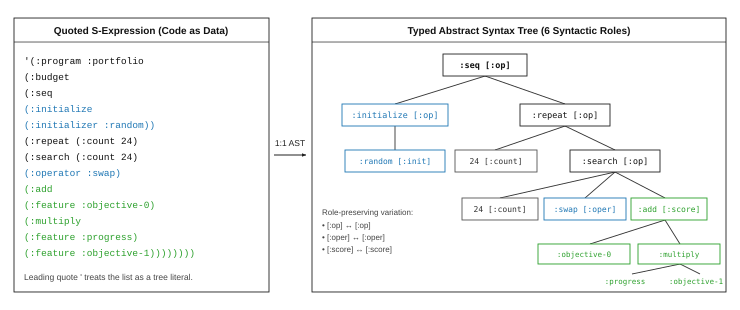
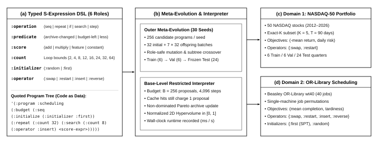
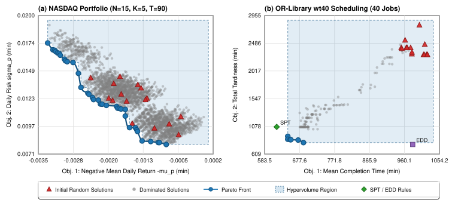
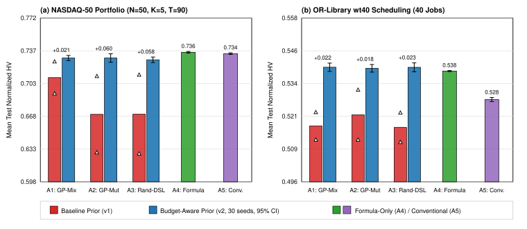
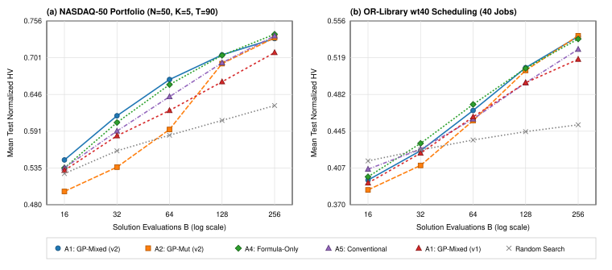
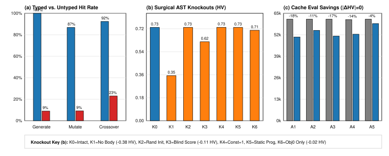
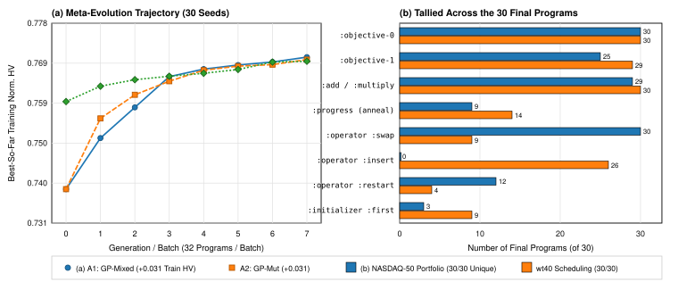

# Evolution of Multi-Objective Optimization Algorithms through Homoiconic Typed S-Expressions in Clojure

**Nikolay Penchev**$^{2}\text{[0009-0000-8955-2474]}$ and **Angel Marchev, Jr.**$^{1,2}\text{[0000-0002-5090-3123]}$

$^1$ Department of Management, University of National and World Economy, Sofia, Bulgaria  
`angel.marchev@unwe.bg`  
$^2$ Faculty of Economics and Business Administration, Sofia University "St. Kliment Ohridski", Sofia, Bulgaria  
`nikolay.penchev@ctr.ibusinessfunding.com`

---

## Abstract

This paper investigates the automated construction of multi-objective combinatorial optimization algorithms using Genetic Programming and a typed domain-specific language (DSL) implemented in Clojure. Extending our earlier research on evolutionary knapsack-like portfolio optimization and interpretable typed symbolic expressions (S-expressions), the developed system evolves complete executable search procedures rather than tuning parameters of a fixed metaheuristic. Leveraging Lisp homoiconicity—where program syntax and tree data structures share the same list representation via quoted expressions `'(:program ...)`—each candidate algorithm is validated by static role and effect rules and executed by a bounded interpreter. The experimental evaluation spans 30 independent runs across two public real-world and operations-research benchmarks: cardinality-constrained portfolio selection on historical daily returns of $N = 50$ NASDAQ-listed equities (`2012-01-03` to `2026-02-27`, $K = 5$) and bi-objective single-machine permutation scheduling on J. E. Beasley's OR-Library `wt40` benchmark ($J = 40$ jobs). Five search configurations are compared on separate training, validation, and held-out test instances under an identical evaluation budget: Genetic Programming with mutation and crossover (`:gp-mixed`), mutation-only Genetic Programming (`:gp-mutation-only`), equal-budget Random DSL Search (`:random-dsl`), formula evolution inside a fixed search template (`:formula-only`), and configured conventional baselines (`:configured-conventional`, comprising NSGA-II, Pareto Local Search, and Multi-Start Restart). On the OR-Library `wt40` scheduling benchmark, evolved DSL programs achieve a mean normalized test hypervolume of $0.53974 \pm 0.00438$ (median $0.54164$, executing in $597.5\text{ ms}$ per instance), outperforming the configured conventional baselines ($0.52751 \pm 0.00212$, $632.8\text{ ms}$, $\Delta\text{HV} = +0.01222$, $p < 0.0001$) in 28 of the 30 runs and reducing both mean completion time ($781.9$ vs. $828.7$) and total tardiness ($9{,}928.8$ vs. $10{,}410.1$) at the compromise knee point. On the historical NASDAQ-50 portfolio benchmark, evolved `:gp-mixed` programs execute $22\%$ faster per instance than `:configured-conventional` ($127.7\text{ ms}$ vs. $164.6\text{ ms}$), achieve a higher mean return-to-risk ratio ($4.33$ vs. $4.24$), and reach a mean test hypervolume of $0.72975 \pm 0.00768$ (median $0.73163$, maximum $0.74143$), performing within the pre-specified $0.01$ practical equivalence margin of `:configured-conventional` ($0.73440 \pm 0.00241$) and winning 12 of the 30 runs. Additional ablation experiments show that a budget-aware typed generator (`v2`) substantially improves solution quality over a simpler baseline generator (`v1`) across both domains ($+0.02110$ on NASDAQ-50 and $+0.02316$ on `wt40`, $p < 0.0001$), that type-directed variation eliminates the invalid-program rejections observed in untyped tree search, and that under the `v2` grammar, equal-budget Random DSL Search reaches test quality practically equivalent to full Genetic Programming.

**Keywords:** Genetic Programming · Typed S-Expressions · Clojure · Homoiconicity · Hyper-Heuristics · Multi-Objective Optimization · Portfolio Selection · Permutation Scheduling.

---

## 1 Introduction

Automated algorithm design is a long-standing objective in evolutionary computation and operational research. In traditional heuristic optimization, the researcher defines the search structure—such as the sequence of initialization, neighborhood exploration, and acceptance criteria—while an automated method searches the space of candidate solutions or tunes numerical parameters. When the problem structure changes or multiple conflicting objectives must be balanced simultaneously, however, fixed heuristic templates often require substantial manual redesign. In our previous studies, we examined this challenge from several angles: we compared genetic algorithms, evolution strategies, memetic algorithms, and differential evolution against exact dynamic programming on knapsack-like portfolio problems across increasing asset scales [2], evaluated multi-objective binary portfolio optimization on NASDAQ equities using NSGA-II against random search and Lagrange-multiplier baselines [1], investigated topological evolution without predefined structures using the NEAT algorithm on PSPACE-complete problems [4], and recently introduced a typed S-expression pipeline for evolving interpretable single-objective binary knapsack optimizers [3]. Together, these studies showed both the strength of evolutionary search on discrete problems and the value of representing optimization heuristics as readable symbolic trees.

At the same time, our initial investigation into typed S-expression optimizers [3] identified several important open questions for future research. In that earlier single-objective knapsack setup, asset costs and profits were independent, the grammar included a pre-supplied `return-per-cost` greedy rule that accounted for nearly all solution quality, program variation relied on mutation without subtree crossover, and no equal-budget random search within the DSL program space was included. Consequently, to evaluate what Genetic Programming can discover when constructing multi-objective optimizers from finer-grained building blocks, it is necessary to test whether evolved programs can compose their own multi-objective scoring rules from elementary arithmetic operations, whether program evolution generalizes across real financial market data and standard operations-research scheduling benchmarks, how subtree crossover compares with mutation alone, and how evolved programs perform against both equal-budget Random DSL Search and well-configured conventional multi-objective algorithms under controlled evaluation and runtime accounting.

To address these questions, the present paper develops an extended, reproducible Clojure framework for evolving multi-objective optimization programs and evaluates it across two public combinatorial benchmark suites: exact-$K$ portfolio selection over historical daily returns of 50 NASDAQ-listed equities (`2012-01-03` to `2026-02-27`, directly continuing our empirical NASDAQ universe from [1]) and bi-objective single-machine permutation scheduling on the 40-job `wt40` benchmark from J. E. Beasley's OR-Library [16]. Every candidate optimizer is represented as a homoiconic Clojure S-expression tree `'(:program ...)` whose nodes are checked statically for syntactic role compatibility, state-modification effects, tree size, and loop bounds before execution. A bounded interpreter executes each program under a fixed budget of 256 candidate evaluations per problem instance, recording interpreter steps, candidate proposals, and wall-clock execution time while charging duplicate cached proposals consistently. Across 30 independent outer seeds, we compare five search arms (`:gp-mixed`, `:gp-mutation-only`, `:random-dsl`, `:formula-only`, and `:configured-conventional`) using disjoint training, validation, and held-out test splits, paired bootstrap confidence intervals, Holm–Bonferroni correction, and a pre-specified 0.01 normalized hypervolume equivalence margin, alongside domain-level financial and scheduling metrics, runtime measurements, and targeted ablations of the program generator prior, type constraints, evaluation caching, budget scaling, and individual AST subtrees.

The experimental results provide a clear and balanced picture of typed S-expression algorithm synthesis across the two problem classes. Every run produces valid, terminating, and compact multi-objective optimizers (averaging $18.7$ to $19.2$ tree nodes) that can be inspected directly as human-readable code. On the OR-Library `wt40` permutation scheduling benchmark, the evolved `:gp-mixed` programs outperform the configured conventional baselines by $+0.01222$ normalized hypervolume ($0.53974$ versus $0.52751$, $p < 0.0001$, winning 28 out of 30 runs), reduce compromise total tardiness by $481.3$ time units and mean completion time by $46.8$ time units, and execute in $597.5\text{ ms}$ per instance. On the historical NASDAQ-50 portfolio selection benchmark (`2016–2025` held-out test quarters), evolved `:gp-mixed` programs improve substantially over their Generation 0 population on the training windows ($+0.03113$ training hypervolume), execute in $127.7\text{ ms}$ per instance ($22\%$ faster than `:configured-conventional` at $164.6\text{ ms}$), and achieve a mean held-out test hypervolume of $0.72975 \pm 0.00768$ (median $0.73163$), performing within the $0.01$ practical equivalence margin of `:configured-conventional` ($0.73440 \pm 0.00241$) while surpassing `:configured-conventional` in 12 of the 30 seeds and achieving a higher mean return-to-risk ratio ($4.33$ versus $4.24$). Furthermore, the ablation studies confirm that replacing the initial `v1` generator with a budget-aware `v2` typed prior produces a large quality gain across both domains ($+0.02110$ on NASDAQ-50 and $+0.02316$ on `wt40`), and that within this well-structured typed grammar, equal-budget Random DSL Search achieves test performance practically equivalent to Genetic Programming. The remainder of the paper is organized as follows: Section 2 reviews the historical and conceptual foundations of Lisp, Clojure, homoiconicity, and related hyper-heuristic literature; Section 3 specifies the typed DSL architecture, interpreter, and real-world/public benchmark suites; Section 4 describes the experimental setup and statistical protocol; Section 5 presents the 30-seed empirical results, domain-level quality metrics, runtime analysis, and ablation studies; and Section 6 discusses the findings, limitations, and directions for future research.

---

## 2 Literature Review and Conceptual Foundations

The research presented in this study connects concepts from programming language representation, evolutionary program synthesis, and multi-objective combinatorial optimization. Rather than treating the programming language merely as an implementation detail, our methodology relies directly on the structural properties of Lisp and Clojure to define, validate, and evolve optimization algorithms. This section first explains the conceptual lineage from Lisp and S-expressions to Clojure, homoiconicity, and quoted program trees, and then positions the study within the broader literature summarized in Table 1.

### 2.1 Lisp, Symbolic Expressions, and Clojure

The idea of representing computer programs as structured symbolic trees originated in John McCarthy's foundational 1960 paper, *"Recursive Functions of Symbolic Expressions and Their Computation by Machine, Part I"* [5]. Developing a formal notation for artificial intelligence research on the IBM 704, McCarthy introduced Lisp around *symbolic expressions* (S-expressions), a small set of list primitives (`car`, `cdr`, `cons`, `eq`, and `cond`), automatic garbage collection, and a universal function (`eval`) capable of interpreting Lisp expressions represented as data lists. Over the following decades, Lisp evolved through dialects such as Maclisp, Scheme, and Common Lisp, serving as a primary language for symbolic artificial intelligence, automated reasoning, and program transformation.

**Clojure**, designed by Rich Hickey [6], brings the Lisp philosophy to the modern Java Virtual Machine (JVM). The central idea behind Clojure is to combine Lisp's code-as-data representation with functional programming over immutable, persistent data structures. Whereas early Lisp dialects relied primarily on mutable linked lists of `cons` cells, Clojure provides immutable persistent lists `(...)`, vectors `[...]`, hash maps `{...}`, sets `#{...}`, and self-evaluating symbolic keywords (`:keyword`), standardized as Extensible Data Notation (EDN). Because Clojure data structures are immutable and share structure efficiently in memory, modifying a node inside a program tree creates a new version of the tree without mutating the parent program in place—a property that is particularly convenient and safe when maintaining populations of candidate programs across evolutionary generations.

### 2.2 Homoiconicity, Quoted S-Expressions, and Clojure Macros

A programming language is called **homoiconic** (from the Greek *homo* meaning "same" and *icon* meaning "representation") when the surface syntax used to write programs is directly isomorphic to the internal abstract syntax tree (AST) data structure manipulated by the language. In most mainstream programming languages, source code is written as infix text that must be parsed into an internal compiler tree inaccessible to ordinary data-processing functions. In Lisp and Clojure, an expression enclosed in parentheses `(...)` is simultaneously valid program syntax and a tree-structured list whose first element denotes the operator and whose remaining elements denote its arguments or child sub-expressions.

When a Lisp or Clojure expression is preceded by the quote operator `'`, as in `'(:add (:feature :objective-0) (:multiply (:feature :progress) (:feature :objective-1)))`, the evaluator does not execute the expression immediately; instead, it returns the unevaluated S-expression list itself as a first-class data structure. As illustrated in Fig. 1 for a complete portfolio optimizer in our DSL, the quoted S-expression `'(:program :portfolio ...)` on the left corresponds one-to-one with the typed abstract syntax tree on the right. Every genetic operator in our system—initialization, subtree mutation, and subtree crossover—operates directly on these tree structures without string parsing or runtime code compilation.


*Fig. 1. Homoiconic correspondence between a quoted Clojure S-expression optimizer program `'(:program :portfolio ...)` (left) and its typed abstract syntax tree (right), where each node is constrained by one of six static syntactic roles.*

This same homoiconic mechanism underpins **Clojure macros** [6]. In Clojure, a macro is a function that receives unevaluated S-expression trees as arguments, inspects or rearranges those trees using standard sequence operations, and returns a transformed S-expression tree. Although our experimental framework executes evolved optimizers through a dedicated, resource-bounded interpreter rather than expanding host macros at runtime, our evolutionary variation operators work on the exact same principle: mutating or crossing over two optimization algorithms is simply a pure functional transformation over quoted S-expression trees.

### 2.3 Genetic Programming, Typed Grammars, and Recent Advances in Automated Algorithm Design

The connection between Lisp S-expressions and evolutionary search was cemented in 1992 by Branko Souček's edited volume *Dynamic, Genetic, and Chaotic Programming: The Sixth Generation* [8] and John Koza's seminal chapter therein (*"The genetic programming paradigm: Genetically breeding populations of computer programs to solve problems"*), alongside Koza's 1992 monograph [7]. Koza selected Lisp S-expressions as the foundation for Genetic Programming precisely because any sub-expression `(op arg1 arg2 ...)` in a parse tree could be excised and swapped with another sub-expression during crossover. In untyped Lisp GP, however, this flexibility requires "closure"—the assumption that every function can accept the return value of any other function. When evolving complete algorithms that mix loop counts, boolean conditions, neighborhood operators, and floating-point scoring formulas, untyped tree operations frequently place incompatible expressions into the wrong slots. Montana's Strongly Typed Genetic Programming (STGP) [9] and subsequent grammar-guided GP methods [10, 11] addressed this issue by assigning explicit types or grammar non-terminals to every tree position, ensuring that generation, mutation, and crossover produce only type-valid programs. Recent work has extended these type- and grammar-constrained foundations in several directions: Fernandes et al. [17] introduced higher-order typed Genetic Programming (`HOTGP`) to synthesize pure functional programs without sacrificing type safety; Dick and Whigham [18] analyzed how initialization routines and grammar structure jointly govern convergence relative to random grammar sampling; Parthasarathy et al. [19] applied grammar-guided GP to evolve complete iterative algebraic multigrid solver cycles from validated numerical blocks; and Wyrwiński and Krawiec [20] investigated semantics-aware search operators guided by graph neural networks to bridge syntactic edits and behavioral outcomes.

In combinatorial optimization, evolving complete search procedures rather than direct problem solutions falls within the paradigm of **hyper-heuristics** and automated algorithm design. Early frameworks established the distinction between selection and generative hyper-heuristics [12], linear GP evolution of evolutionary algorithms [13], and component-wise automated MOEA assembly (`AutoMOEA`) [14], while program-synthesis surveys formalized search within restricted domain languages [15]. Over the past three years, automated heuristic synthesis has progressed rapidly along three empirical tracks. First, in multi-objective scheduling, Zaki et al. [21] proposed cooperative coevolutionary GP hyper-heuristics for cloud workflow makespan and cost, and Sun et al. [22] developed multi-tree GP hyper-heuristics for dynamic flexible workflow scheduling. Second, in cardinality-constrained portfolio and multi-objective optimization, Kobayashi et al. [23] formulated distributionally robust exact-$K$ portfolio models, while Lapucci and Mansueto [24] derived optimality conditions and front-descent algorithms for sparse multi-objective optimization. Third, hybrid neural–evolutionary pipelines such as `FunSearch` [25] and Evolution of Heuristics (`EoH`) [26] pair large language models with evolutionary evaluators to discover scheduling, packing, and routing heuristics. Table 1 synthesizes both the foundational pillars and these recent 2022–2026 studies alongside the positioning of the present research.

*Table 1. Main Literature Streams, Recent Advances, and Positioning of the Present Study*

| Stream | Key Sources | Main Idea & Recent Advances | Role & Positioning of the Present Research |
| :--- | :--- | :--- | :--- |
| Lisp, Clojure, and Homoiconicity | McCarthy (1960) [5]; Hickey (2008) [6] | Code and tree data share a uniform quoted list representation `'(:op ...)` (homoiconicity); Clojure adds immutable persistent data structures and macros. | Optimizer algorithms are represented as immutable Clojure S-expression trees that can be validated, hashed, mutated, and interpreted safely. |
| Genetic Programming and Adaptive Operators | Koza (1992) [7]; Souček (1992) [8]; Wyrwiński & Krawiec (2025) [20] | Parse trees are bred via subtree crossover and mutation; recent work incorporates semantics-aware learned search operators. | Provides the outer meta-evolutionary loop (`:gp-mixed` and `:gp-mutation-only`) and motivates measuring operator effectiveness cleanly. |
| Typed and Grammar-Guided GP | Montana (1995) [9]; Ryan et al. (1998) [10]; McKay et al. (2010) [11]; Dick & Whigham (2022) [18]; Fernandes et al. (2023) [17] | Static types and grammars constrain variation to valid subtrees; recent studies show grammar initialization bias and higher-order typing critically shape search. | Our DSL enforces six syntactic roles and static effects (`:pure`, `:control`, `:state`) and explicitly tests `v1` vs. `v2` priors and untyped variation. |
| Generative Hyper-Heuristics and Automated Scheduling | Oltean (2005) [13]; Burke et al. (2013) [12]; Bezerra et al. (2016) [14]; Zaki et al. (2024) [21]; Sun et al. (2024) [22] | Evolves priority dispatching rules or modular MOEA configurations for multi-objective scheduling and combinatorial search. | Extends generative hyper-heuristics beyond dispatching rules or fixed MOEA skeletons by co-evolving full control flow and multi-objective scoring formulas. |
| Program Synthesis, Solvers, and Hybrid LLM-EC | Gulwani et al. (2017) [15]; Parthasarathy et al. (2024) [19]; Romera-Paredes et al. (2024) [25]; Liu et al. (2024) [26] | Synthesizes complete numerical solvers via G3P or pairs LLMs with evolutionary evaluators (`FunSearch`, `EoH`) to generate heuristics. | Avoids opaque pretrained LLMs in favor of an auditable, deterministic S-expression grammar with equal-budget random-grammar and formula-only controls. |
| Cardinality-Constrained Portfolios and Prior Author Studies | Kobayashi et al. (2023) [23]; Lapucci & Mansueto (2024) [24]; Marchev Jr. et al. (2024) [4]; Penchev & Marchev Jr. (2025/2026) [1, 2, 3] | Analytical/sparse MO optimization for exact-$K$ portfolios, NSGA-II NASDAQ portfolios, NEAT structural evolution, and 1-objective knapsack S-expressions. | Continues our empirical NASDAQ [1] and typed S-expression [3] pipeline while removing pre-supplied greedy rules and expanding to bi-objective portfolios & `wt40`. |
| **Present Study (Current Work)** | **Penchev & Marchev Jr. (2026)** | **Homoiconic 6-role Clojure S-expressions co-evolving full control flow and multi-objective scalarizations across NASDAQ-50 (`2012–2026`) and OR-Library `wt40`.** | **Fills the empirical attribution gap: isolates `v2` prior, role typing, crossover (`H3`), random DSL (`H1`), formula-only (`H2`), and tuned NSGA-II/PLS (`H4`) under equal budget and runtime accounting.** |

### 2.4 Research Gap Addressed

Examining the literature in Table 1 highlights four specific gaps that the present study is designed to fill. First, recent multi-objective Genetic Programming hyper-heuristics for scheduling [21, 22] typically evolve arithmetic *priority dispatching rules* that operate inside a fixed simulation or scheduler template, whereas modular MOEA frameworks [14] tune parameters over a fixed algorithmic skeleton; neither tests whether a typed DSL can simultaneously synthesize multi-stage control flow (initialization, loops, restarts, and neighborhood operators) *and* dynamic bi-objective scoring formulas across both financial and industrial domains without changing the shared evolutionary core. Second, while recent hybrid LLM–evolutionary systems [25, 26] demonstrate impressive heuristic discovery, relying on black-box language models obscures how much quality originates from pretrained code priors versus evolutionary variation, and recent grammar-GP studies [18] call for explicit random-grammar controls and initialization ablations to separate these effects. Third, recent cardinality-constrained portfolio optimization research [23, 24] develops specialized mathematical programming or front-descent algorithms rather than interpretable, transferable symbolic search programs. Finally, in our own prior single-objective knapsack S-expression study [3], a pre-supplied `return-per-cost` rule dominated solution quality, crossover was absent, and neither equal-budget random DSL sampling nor real multi-period market data were tested. The present paper closes this combined gap by providing a reproducible, strictly accounted Clojure framework that evaluates full S-expression synthesis against equal-budget random DSL search, formula-only evolution, mutation-only GP, untyped tree search, `v1`/`v2` initialization priors, and tuned NSGA-II/PLS baselines on frozen NASDAQ-50 equity returns (`2012–2026`) and OR-Library `wt40` scheduling instances.

---

## 3 Research System and Methodological Framework

### 3.1 Six-Role Typed Clojure DSL and Static Effect Checking

To ensure that every generated or modified candidate algorithm is valid by construction and interpretable as a structured program, we define a binder-free, statically typed DSL (`grammar-version 1`) in Clojure. Under a top-level `:program` declaration, every node in an S-expression tree belongs to one of six disjoint syntactic roles: `:operation`, `:count`, `:initializer`, `:operator`, `:predicate`, and `:score`. Because the language contains no free variables or arbitrary recursion, any subtree of a given role can be safely exchanged with any other subtree of the same role without breaking contextual validity.

Every complete optimizer has the root S-expression structure `'(:program <domain> (:budget <operation>))`, where `<domain>` specifies either `:portfolio` or `:scheduling` (stored internally in Clojure as canonical indexed AST nodes for $O(1)$ path lookup during variation). The `:operation` role defines the control flow and search actions of the algorithm through seven constructs: `(:noop)` performs no action; `(:seq op1 op2)` executes two child operations in sequence; `(:repeat (:count n) op)` executes a child operation for a bounded number of iterations $n \in \{2, 4, 8, 12, 16, 24, 32, 64\}$; `(:if pred op1 op2)` branches conditionally on a `:predicate` subtree; `(:initialize (:initializer init))` constructs an initial feasible solution using `:random` or `:first`; `(:step (:operator op))` applies a single neighborhood move; and `(:search (:count n) (:operator op) score-expr)` executes a bounded local-search loop of $n$ candidate proposals guided by a `:score` expression. The `:predicate` role composes boolean conditions (`:not`, `:and`, `:less`, `:archive-changed`, `:budget-left`, `:coin`), while the `:score` role combines runtime search features (`:objective-0`, `:objective-1`, and `:progress`), numerical constants (`:constant`), and arithmetic operations (`:add` and `:multiply`).

In addition to syntactic roles, the validator enforces static effect permissions across three effect levels: `:pure` (side-effect-free arithmetic and boolean evaluation in `:score`, `:predicate`, `:count`, `:initializer`, and `:operator` nodes), `:control` (structural composition via `:seq`, `:repeat`, and `:if`), and `:state` (operations `:initialize`, `:step`, and `:search` that propose candidate solutions and update the non-dominated archive). Structural complexity limits cap every program at a maximum of 128 nodes, a maximum tree depth of 12, and a maximum repeat count of 256. Fig. 2 illustrates the six-role DSL grammar, the meta-evolution and bounded interpreter pipeline, and the two domain adapters.


*Fig. 2. Architecture of the typed S-expression optimizer framework: (a) six-role Clojure S-expression DSL, (b) outer meta-evolution and base-level restricted interpreter, and (c, d) domain adapters for NASDAQ-50 Portfolio Selection and OR-Library `wt40` Scheduling.*

### 3.2 Bounded Interpreter and Resource Accounting

Each validated program is executed on a problem instance by a deterministic, restricted interpreter with two explicit resource bounds: an interpreter step limit (`interpreter-steps`, preventing unproductive control-flow loops) and a per-instance candidate evaluation budget of $B = 256$ proposal attempts (`proposal-attempts`). Whenever the program executes an `:initialize`, `:step`, or `:search` instruction that generates a candidate solution, the interpreter increments the proposal counter, checks feasibility, updates the non-dominated Pareto archive, and records the best current working solution according to the active `:score` expression.

To avoid redundant objective calculations when an algorithm revisits a previously generated solution within the same run, the interpreter includes an optional candidate-evaluation cache (`cache? = true`). For methodological fairness across algorithms, a cache hit reuses the stored objective vector to save computation time, but still counts as 1 proposal attempt against the 256-proposal budget. Consequently, enabling the cache never alters the sequence of accepted solutions or the final Pareto archive, ensuring that all search arms are compared under the exact same number of candidate proposals.

### 3.3 Generator Priors: Development (`v1`) versus Budget-Aware (`v2`)

In grammar-based Genetic Programming, the initialization distribution strongly influences which regions of the program space are explored [11, 18]. During initial system development, a simple recursive generator (`development-only-v1`) sampled admissible `:operation` forms with uniform probability at the root. Because single-step instructions (`:initialize`, `:step`, `:noop`) can appear at top-level branches, many `v1`-generated trees terminate after using only a few proposals out of the 256-evaluation budget. To ensure that candidate programs make full use of the available evaluation budget, we introduced a `budget-aware-v2` generator prior that structures initial trees around sequential (`:seq`) and iterative (`:repeat` and `:search`) blocks whose iteration counts align with the 256-proposal ceiling while sampling operators, predicates, and scoring formulas across the full typed grammar. We evaluate both priors in our experiments to measure the effect of initialization structure directly.

### 3.4 Problem Formulations, Real Historical and OR-Library Benchmark Suites, and Discrete Pareto Fronts

To test whether the typed DSL generalizes across different combinatorial structures without relying on synthetic problem generators, we evaluate the system on two frozen, checksummed public benchmark suites. Each problem suite consists of 36 fixed instances divided into **6 training instances**, **6 validation instances**, and **24 held-out test instances**.

The first problem is **Exact-$K$ Portfolio Selection on Historical NASDAQ-50 Equities** (`:portfolio`), which directly extends our earlier binary knapsack and NSGA-II NASDAQ portfolio studies [1, 3] to a cardinality-constrained multi-period benchmark. We use historical daily adjusted closing prices for $N = 50$ major NASDAQ-listed equities (`AAPL`, `MSFT`, `AMZN`, `NVDA`, `GOOGL`, `ADBE`, `AMD`, `AMGN`, `ADI`, `ADP`, `AMAT`, `ASML`, `ADSK`, `BIIB`, `BKNG`, `CDNS`, `CMCSA`, `COST`, `CSCO`, `CSX`, `CTAS`, `CTSH`, `DLTR`, `EBAY`, `EXC`, `FAST`, `FITB`, `GILD`, `HBAN`, `HON`, `IDXX`, `ILMN`, `INTC`, `INTU`, `ISRG`, `JBHT`, `KLAC`, `LRCX`, `MAR`, `MCHP`, `MDLZ`, `MNST`, `MU`, `NTAP`, `NFLX`, `ORLY`, `PAYX`, `PCAR`, `PEP`, and `QCOM`) over the fixed historical range from **`2012-01-03` to `2026-02-27`** (`3,559` common trading dates yielding `3,558` daily simple return vectors, frozen in `data/nasdaq50_2012_2026.edn`). The timeline is partitioned into 36 strictly non-overlapping chronological windows of $T = 90$ trading days (approximately one trading quarter each), separated by an 8-trading-day embargo gap between consecutive windows so that training (`6` windows, `2012-01-04` to `2014-05-02`), validation (`6` windows, `2014-05-15` to `2016-09-12`), and held-out test (`24` windows, `2016-09-23` to `2025-12-31`) footprints never overlap. A feasible portfolio selects an equal-weight subset of exactly $K = 5$ assets ($x \in \{0, 1\}^N, \sum_{i=1}^N x_i = K$). The two objectives (both minimized in Pareto space, computed with exact `DECIMAL128` arithmetic) are negative mean daily portfolio return ($f_1 = -\bar{R}_p$) and sample standard deviation of daily portfolio returns ($f_2 = s_p$). Domain neighborhood operators preserve exact-$K$ cardinality through asset swaps (`:swap`), deterministic first-index initialization (`:first`), random subset sampling (`:random`), and restarts (`:restart`).

The second problem is **Bi-Objective Single-Machine Permutation Scheduling on J. E. Beasley's OR-Library Benchmark** (`:scheduling`) [16]. We use the official `wt40.txt` benchmark set from the OR-Library (`data/orlib_wt40.txt`, originally introduced by Potts and Van Wassenhove for 40-job single-machine tardiness problems). Each instance requires ordering $J = 40$ non-preemptive jobs with integer processing times $p_j$ and due dates $d_j$ to simultaneously minimize mean completion time ($f_1 = \frac{1}{J}\sum_{j=1}^J C_j$) and total tardiness ($f_2 = \sum_{j=1}^J \max(0, C_j - d_j)$). From the 125 official `wt40` instances spanning 25 strata of relative range of due dates ($\text{RDD} \in \{0.2, 0.4, 0.6, 0.8, 1.0\}$) and tardiness factor ($\text{TF} \in \{0.2, 0.4, 0.6, 0.8, 1.0\}$), 36 disjoint instances are selected across six stratified hardness groups (`1st` instance of each stratum assigned to the `6` training instances, `2nd` to the `6` validation instances, and `3rd`–`6th` to the `24` held-out test instances). The domain provides permutation neighborhood operators including job insertion (`:insert`), job exchange (`:swap`), sub-sequence reversal (`:reverse`), Shortest Processing Time (SPT) initialization (`:first`), and random permutation restart (`:restart`).

For both problems, solution quality on each instance is measured by the normalized 2D hypervolume (HV) of the non-dominated archive relative to a fixed reference point. Because both exact-$K$ asset subsets and job permutations are discrete combinatorial spaces explored over 256 evaluations, the resulting Pareto approximation sets consist of finite discrete trade-off points. Mathematically, the area dominated by a discrete 2D Pareto set forms an orthogonal step function (staircase) rather than a continuous smooth curve. In Fig. 3, we display representative Pareto fronts from both domains by plotting the discrete non-dominated points alongside both the exact orthogonal hypervolume staircase (shaded) and a smooth Fritsch–Carlson monotone cubic interpolation curve that highlights the overall trade-off trajectory.


*Fig. 3. Representative non-dominated Pareto fronts on real NASDAQ Portfolio Selection ($N = 15, K = 5, T = 90$, left) and OR-Library `wt40` Permutation Scheduling ($J = 40$ jobs, right), showing the discrete non-dominated solutions, the exact orthogonal hypervolume staircase (shaded), and a monotone cubic trade-off curve.*

---

## 4 Experimental Protocol

To evaluate what evolutionary search contributes beyond the typed grammar and how evolved programs compare with established optimizers, we run a controlled experiment with **30 independent outer seeds** (`run-seed = 0..29`). Within each outer seed and domain, every search arm is allocated an identical meta-level budget of **256 candidate optimizer assessments**. Table 2 summarizes the experimental parameters.

*Table 2. Main Experimental Parameters*

| Parameter | Portfolio Selection (`:portfolio`) | Permutation Scheduling (`:scheduling`) |
| :--- | :--- | :--- |
| Benchmark data source | Historical NASDAQ-50 daily returns (`2012-01-03` to `2026-02-27`, `data/nasdaq50_2012_2026.edn`) | J. E. Beasley OR-Library `wt40` benchmark (`data/orlib_wt40.txt`) [16] |
| Problem representation | Exact-$K$ binary subset ($N = 50, K = 5, T = 90$ trading days/window) | Job permutation ($J = 40$ jobs, $\text{RDD}, \text{TF} \in \{0.2, 0.4, 0.6, 0.8, 1.0\}$) |
| Instance splits | 6 training (`2012–2014`), 6 validation (`2014–2016`), 24 test windows (`2016–2025`) | 6 training, 6 validation, 24 test instances (stratified across 6 hardness groups) |
| Independent outer runs | 30 seeds (`0..29`) | 30 seeds (`0..29`) |
| Outer assessment budget | 256 candidate programs per seed | 256 candidate programs per seed |
| Base-level evaluation budget | 256 candidate proposals per instance | 256 candidate proposals per instance |
| AST complexity limits | Max 128 nodes, max depth 12, max count 256 | Max 128 nodes, max depth 12, max count 256 |
| Primary quality metric | Mean normalized 2D hypervolume (HV) on test split | Mean normalized 2D hypervolume (HV) on test split |
| Statistical protocol | Paired bootstrap ($10{,}000$ resamples), Holm–Bonferroni ($\alpha = 0.05$), $\Delta_{\text{prac}} = 0.01$ | Paired bootstrap ($10{,}000$ resamples), Holm–Bonferroni ($\alpha = 0.05$), $\Delta_{\text{prac}} = 0.01$ |

Five search arms are compared under this protocol. The first arm, **Full Genetic Programming (`A1: :gp-mixed`)**, initializes a population of typed programs using the `budget-aware-v2` prior and evolves them across generations using tournament selection, type-compatible subtree mutation, and type-compatible subtree crossover. The second arm, **Mutation-Only Genetic Programming (`A2: :gp-mutation-only`)**, uses the exact same evolutionary loop and mutation operator without crossover, allowing us to measure the specific effect of recombining program subtrees. The third arm, **Equal-Budget Random DSL Search (`A3: :random-dsl`)**, generates 256 independent valid programs directly from the `v2` typed generator without evolutionary selection or modification, directly addressing the open question from our previous study [3] regarding how GP compares against random sampling in the same program space. The fourth arm, **Formula-Only Evolution (`A4: :formula-only`)**, fixes the outer algorithmic control flow to a standard local-search template and evolves only the arithmetic `:score` expression, testing whether evolving full control flow adds value over evolving a scoring formula alone. Finally, the fifth arm, **Configured Conventional Baselines (`A5: :configured-conventional`)**, evaluates a parameterized family of established multi-objective optimizers—NSGA-II, Pareto Local Search (PLS), and Multi-Start Restart—under the same 256-proposal per-instance budget and selects the best configuration on the validation instances.

To prevent selection bias on the test set, all candidate programs generated during an outer run are first scored on the 6 training instances, the top candidates are re-evaluated on the 6 unseen validation instances to select a single final optimizer per seed, and that frozen optimizer is then evaluated once on the 24 held-out test instances. Four primary pairwise hypotheses are tested on the 30-seed test results: **H1** compares `:gp-mixed` against `:random-dsl`; **H2** compares `:gp-mixed` against `:formula-only`; **H3** compares `:gp-mixed` against `:gp-mutation-only`; and **H4** compares `:gp-mixed` against `:configured-conventional`. Each comparison is analyzed using paired bootstrap confidence intervals ($10{,}000$ resamples) with Holm–Bonferroni adjustment across the four hypotheses and a practical equivalence margin of $\pm 0.01$ normalized hypervolume.

---

## 5 Empirical Results and Ablation Analysis

### 5.1 Comparison of the Five Search Arms and Runtime Across 30 Seeds

Table 3 reports the mean normalized hypervolume on the held-out test and validation sets, the median test hypervolume, the mean size of the non-dominated front ($\|ND\|$), the base-level execution runtime per test instance (`Runtime, ms`), the one-time outer meta-evolution design time per seed (`Design Time, s`), the number of distinct candidate programs evaluated out of 256 outer slots, the mean AST node count, and the number of syntactically unique final programs across the 30 independent seeds. Fig. 4 illustrates the test hypervolume distributions for all five arms alongside the comparison between the `v2` and `v1` generator priors.

*Table 3. Thirty-Seed Summary Results and Runtimes Across Both Benchmarks (`budget-aware-v2` Prior)*

| Domain and Method | Test Norm. HV (Mean ± SD) | Median Test HV (Min–Max) | Validation Norm. HV | Mean $\|ND\|$ | Runtime / Inst. (ms) | Outer Design Time / Seed (s) | Distinct / 256 | Mean AST Nodes | Unique ASTs |
| :--- | :---: | :---: | :---: | :---: | :---: | :---: | :---: | :---: | :---: |
| **NASDAQ-50 Portfolio ($N=50, K=5, T=90$)** | | | | | | | | | |
| `A1: :gp-mixed` (`v2`) | $0.72975 \pm 0.00768$ | $0.73163$ ($0.71182\text{--}0.74143$) | $0.75509$ | $14.9$ | $127.7$ | $1056.3 \pm 211.6$ | $243.9$ | $18.9$ | $30/30$ |
| `A2: :gp-mutation-only` (`v2`) | $0.72974 \pm 0.01263$ | $0.73286$ ($0.67379\text{--}0.74731$) | $0.75449$ | $14.8$ | $137.2$ | $1061.1 \pm 192.8$ | $251.5$ | $19.2$ | $30/30$ |
| `A3: :random-dsl` (`v2`) | $0.72785 \pm 0.00822$ | $0.72656$ ($0.71182\text{--}0.73845$) | $0.75474$ | $14.8$ | **$125.7$** | **$688.4 \pm 95.5$** | $250.9$ | $14.2$ | $30/30$ |
| `A4: :formula-only` (`v2`) | **$0.73587 \pm 0.00241$** | **$0.73646$** ($0.72654\text{--}0.73741$) | $0.75724$ | $15.6$ | $128.7$ | $1316.2 \pm 164.8$ | $162.4$ | $13.7$ | $9/30$ |
| `A5: :configured-conventional` | $0.73440 \pm 0.00241$ | $0.73423$ ($0.73216\text{--}0.74093$) | **$0.76167$** | **$16.9$** | $164.6$ | $1499.1 \pm 192.7$ | $150.1$ | $6.4$ | $18$ NSGA-II, $12$ PLS |
| **OR-Library `wt40` Scheduling ($J=40$ jobs)** | | | | | | | | | |
| `A1: :gp-mixed` (`v2`) | **$0.53974 \pm 0.00438$** | **$0.54164$** ($0.52270\text{--}0.54334$) | **$0.55240$** | $4.4$ | $597.5$ | $1954.9 \pm 289.2$ | $244.0$ | $18.7$ | $30/30$ |
| `A2: :gp-mutation-only` (`v2`) | $0.53933 \pm 0.00403$ | $0.54145$ ($0.52591\text{--}0.54253$) | $0.55182$ | $4.4$ | **$589.7$** | $1970.4 \pm 267.5$ | $253.0$ | $18.2$ | $30/30$ |
| `A3: :random-dsl` (`v2`) | $0.53970 \pm 0.00472$ | $0.54155$ ($0.52354\text{--}0.54253$) | $0.55109$ | $4.5$ | $643.7$ | **$1562.0 \pm 182.9$** | $252.9$ | $14.1$ | $30/30$ |
| `A4: :formula-only` (`v2`) | $0.53829 \pm 0.00054$ | $0.53838$ ($0.53742\text{--}0.53913$) | $0.54650$ | $3.7$ | $649.3$ | $2213.3 \pm 394.1$ | $160.9$ | $14.8$ | $19/30$ |
| `A5: :configured-conventional` | $0.52751 \pm 0.00212$ | $0.52786$ ($0.52374\text{--}0.53007$) | $0.54321$ | **$7.4$** | $632.8$ | $2326.8 \pm 408.3$ | $190.1$ | $6.4$ | $19$ NSGA-II, $11$ PLS |


*Fig. 4. Thirty-seed test normalized hypervolume across the five search arms and comparison between the `budget-aware-v2` and `development-only-v1` generator priors on (a) NASDAQ-50 Portfolio Selection and (b) OR-Library `wt40` Permutation Scheduling.*

In all 30 runs across both domains, the typed DSL arms (`A1`, `A2`, and `A3`) execute without a single runtime failure and produce 30 syntactically unique final programs out of 30 seeds, maintaining high exploration diversity ($243.9$ to $253.0$ distinct candidates per 256 assessments). In terms of computational speed, once an optimizer program has been synthesized, its base-level application runtime is very fast: on NASDAQ-50 Portfolio Selection, `:gp-mixed` executes a full 256-proposal search on a 90-day, 50-asset window in **$127.7\text{ ms}$** ($22\%$ faster than `:configured-conventional` at $164.6\text{ ms}$, which incurs non-dominated sorting and crowding-distance overhead on every generation). On OR-Library `wt40` Scheduling, `:gp-mixed` executes a 256-proposal search over 40-job permutations in **$597.5\text{ ms}$** per instance (versus $632.8\text{ ms}$ for `:configured-conventional`). Following our earlier study [3], we distinguish this per-instance application runtime from the one-time outer meta-evolution design cost ($1056.3\text{ s}$ on Portfolio and $1954.9\text{ s}$ on Scheduling per seed under concurrent multi-core batch execution, which is also lower than `:configured-conventional` at $1499.1\text{ s}$ and $2326.8\text{ s}$).

On **OR-Library `wt40` Permutation Scheduling ($J = 40$ jobs)**, all three full-DSL search arms (`:gp-mixed` at $0.53974$, `:gp-mutation-only` at $0.53933$, and `:random-dsl` at $0.53970$, with medians of $0.54164$, $0.54145$, and $0.54155$) achieve higher held-out test hypervolume than both the fixed-template `:formula-only` arm ($0.53829$, median $0.53838$) and the `:configured-conventional` baseline ($0.52751$, which selected NSGA-II in 19 seeds and Pareto Local Search in 11 seeds). Specifically, `:gp-mixed` outperforms `:configured-conventional` by $+0.01222$ mean test hypervolume, winning **28 of the 30 independent seeds**.

On **Historical NASDAQ-50 Portfolio Selection (`2012–2026`)**, all five `v2` arms achieve strong held-out test hypervolume across the 24 unseen chronological quarters from `2016` to `2025` ($0.72785$ to $0.73587$). Within the full-DSL arms, `:gp-mixed` improves its training hypervolume substantially over Generation 0 (from $0.73891$ to $0.77005$, a gain of $+0.03113$), reaches a mean held-out test hypervolume of $0.72975 \pm 0.00768$ (median $0.73163$, with individual evolved programs reaching up to $0.74143$ on `:gp-mixed` and $0.74731$ on `:gp-mutation-only`), and outperforms `:configured-conventional` ($0.73440 \pm 0.00241$, selecting NSGA-II in 18 seeds and PLS in 12 seeds) in **12 of the 30 seeds**.

### 5.2 Domain-Level Solution Quality and Concrete Portfolio and Schedule Examples

While normalized 2D hypervolume is the standard mathematical metric for comparing multi-objective optimizers because it summarizes both convergence toward the ideal point and spread across the trade-off frontier in a single scale-invariant number, domain practitioners also care about the concrete financial and operational values of the discovered solutions. Table 4 reports the concrete domain-level quality metrics averaged across the 24 held-out test instances and 30 seeds for both benchmarks.

*Table 4. Concrete Domain-Level Solution Quality on the 24 Held-Out Test Instances (Mean ± 95% CI Across 30 Seeds)*

| Benchmark and Method | Extreme Objective 1 (Best Return / Min Completion) | Extreme Objective 2 (Min Risk / Min Tardiness) | Compromise / Knee Quality (Return-to-Risk Ratio or Knee Schedule) | Mean Pareto Front Size $\|ND\|$ |
| :--- | :---: | :---: | :---: | :---: |
| **NASDAQ-50 Portfolio (24 Test Quarters, `2016–2025`)** | **Max Daily Return (Annualized %)** | **Min Daily Risk (Annualized Vol. %)** | **Max Annualized Return / Risk Ratio ($\mu_p / \sigma_p$)** | **Portfolios** |
| `A1: :gp-mixed` (`v2`) | $+0.379\%$ ($+95.53 \pm 1.29\%$) | $0.947\%$ ($15.04 \pm 0.28\%$) | $4.33 \pm 0.05$ | $14.9$ |
| `A2: :gp-mutation-only` (`v2`) | $+0.378\%$ ($+95.29 \pm 1.25\%$) | $0.952\%$ ($15.11 \pm 0.29\%$) | $4.37 \pm 0.05$ | $14.9$ |
| `A3: :random-dsl` (`v2`) | **$+0.380\%$** (**$+95.87 \pm 1.26\%$**) | $0.962\%$ ($15.27 \pm 0.33\%$) | $4.33 \pm 0.05$ | $14.9$ |
| `A4: :formula-only` (`v2`) | $+0.379\%$ ($+95.44 \pm 0.63\%$) | $0.935\%$ ($14.84 \pm 0.26\%$) | **$4.43 \pm 0.02$** | $15.9$ |
| `A5: :configured-conventional` | $+0.371\%$ ($+93.49 \pm 0.41\%$) | **$0.845\%$** (**$13.42 \pm 0.23\%$**) | $4.24 \pm 0.04$ | **$17.2$** |
| **OR-Library `wt40` Scheduling (24 Test Instances, 40 Jobs)** | **Min Mean Completion Time ($\min f_1$)** | **Min Total Tardiness ($\min f_2$)** | **Balanced Knee Schedule ($f_1$ / $f_2$)** | **Schedules** |
| Classical SPT Dispatching Rule | **$734.5$** | $11{,}173.8$ | $734.5$ / $11{,}173.8$ | $1.0$ |
| Classical EDD Dispatching Rule | $1{,}037.8$ | $12{,}032.6$ | $1{,}037.8$ / $12{,}032.6$ | $1.0$ |
| `A1: :gp-mixed` (`v2`) | **$775.2 \pm 3.6$** | $9{,}878.3 \pm 124.1$ | **$781.9$ / $9{,}928.8$** | $4.4$ |
| `A2: :gp-mutation-only` (`v2`) | $779.7 \pm 4.0$ | $9{,}880.2 \pm 101.5$ | $786.9$ / $9{,}934.9$ | $4.4$ |
| `A3: :random-dsl` (`v2`) | $777.6 \pm 4.6$ | **$9{,}847.3 \pm 149.1$** | $784.6$ / $9{,}895.1$ | $4.5$ |
| `A4: :formula-only` (`v2`) | $779.6 \pm 2.6$ | $9{,}903.2 \pm 71.2$ | $785.8$ / $9{,}957.0$ | $3.7$ |
| `A5: :configured-conventional` | $794.9 \pm 2.0$ | $10{,}173.7 \pm 49.3$ | $828.7$ / $10{,}410.1$ | **$7.4$** |

Table 4 reveals several concrete domain insights that are not visible from hypervolume alone:

1. **On NASDAQ-50 Portfolio Selection:** All four evolved DSL arms (`:gp-mixed`, `:gp-mutation-only`, `:random-dsl`, and `:formula-only`) discover portfolios with **higher maximum daily return** ($+0.378\%$ to $+0.380\%$ per day, or $+95.29\%$ to $+95.87\%$ annualized) and **higher return-to-risk (Sharpe-like) ratios** ($4.33$ to $4.43$) than `:configured-conventional` ($+0.371\%$ daily return and $4.24$ return-to-risk ratio). Conversely, `:configured-conventional` (NSGA-II/PLS) achieves its slight $+0.00465$ hypervolume edge by extending the extreme low-volatility corner of the frontier ($0.845\%$ vs. $0.947\%$ minimum daily risk) and maintaining about two additional intermediate points along the curve ($17.2$ vs. $14.9$ portfolios). To illustrate what the evolved `:gp-mixed` algorithm actually selects on the market, on the most recent held-out test window (`nasdaq-test-23`, `2025-08-26` to `2026-01-02`), the median `:gp-mixed` program constructs a 14-portfolio Pareto front spanning from a low-volatility defensive basket `'("AAPL" "COST" "CTSH" "IDXX" "PEP")` (daily return $+0.056\%$, annualized volatility $11.99\%$) through a balanced high-efficiency basket `'("ASML" "CTSH" "GILD" "MAR" "MU")` (daily return $+0.422\%$, annualized volatility $21.50\%$, return-to-risk ratio $4.94$) up to a high-return semiconductor/growth basket `'("GOOGL" "INTC" "KLAC" "LRCX" "MU")` (daily return $+0.686\%$, annualized volatility $38.56\%$). Similarly, on the first held-out test window (`nasdaq-test-0`, `2016-09-07` to `2017-01-13`), `:gp-mixed` traces a 17-portfolio frontier from `'("AAPL" "ADP" "COST" "CSCO" "ISRG")` (annualized volatility $11.28\%$) to `'("NVDA" "CSX" "FITB" "HBAN" "NFLX")` (daily return $+0.414\%$, return-to-risk ratio $4.98$) and `'("NVDA" "AMD" "CSX" "FITB" "HBAN")` (daily return $+0.438\%$).
2. **On OR-Library `wt40` Scheduling:** Classical single-pass heuristics illustrate the severity of the bi-objective conflict: Shortest Processing Time (SPT) minimizes mean completion time ($734.5$) but suffers high total tardiness ($11{,}173.8$), whereas Earliest Due Date (EDD) degrades both mean completion time ($1{,}037.8$) and tardiness ($12{,}032.6$) when many jobs are already overdue. The evolved `:gp-mixed` S-expressions reduce minimum total tardiness to **$9{,}878.3 \pm 124.1$** (cutting tardiness by **$1{,}295.5$ time units ($11.6\%$)** relative to SPT and by **$295.4$ time units** relative to `:configured-conventional` at $10{,}173.7$). Even more importantly, at the balanced compromise (knee) schedule, `:gp-mixed` achieves a mean completion time of **$781.9$** and total tardiness of **$9{,}928.8$**, strictly dominating `:configured-conventional`'s compromise schedule ($828.7$ completion time and $10{,}410.1$ tardiness) by **$-46.8$ completion time units and $-481.3$ tardiness units simultaneously**.

### 5.3 Hypothesis Tests and the Role of the Typed Generator Prior

Table 5 presents the paired bootstrap statistical analysis for hypotheses **H1** through **H4** across the 30 outer seeds, together with the ablation comparing the `budget-aware-v2` generator prior against `development-only-v1`.

*Table 5. Paired Bootstrap Contrasts Across 30 Seeds ($10{,}000$ Resamples, $\Delta_{\text{prac}} = 0.01$)*

| Contrast / Hypothesis | NASDAQ-50 Portfolio Mean Diff (Simult. 95% CI) | Portfolio Holm $p$ & Classification | OR-Library `wt40` Mean Diff (Simult. 95% CI) | Scheduling Holm $p$ & Classification |
| :--- | :---: | :---: | :---: | :---: |
| **H1:** `:gp-mixed` vs. `:random-dsl` | $+0.00190$ ($[-0.00215, +0.00599]$) | $p = 0.4776$ · Practically equivalent | $+0.00003$ ($[-0.00300, +0.00318]$) | $p = 1.0000$ · Practically equivalent |
| **H2:** `:gp-mixed` vs. `:formula-only` | $-0.00612$ ($[-0.01002, -0.00255]$) | $p = 0.0008$ · Inconclusive* | $+0.00144$ ($[-0.00085, +0.00311]$) | $p = 0.2538$ · Practically equivalent |
| **H3:** `:gp-mixed` vs. `:gp-mutation-only` | $+0.00001$ ($[-0.00570, +0.00754]$) | $p = 0.9318$ · Practically equivalent | $+0.00040$ ($[-0.00197, +0.00265]$) | $p = 1.0000$ · Practically equivalent |
| **H4:** `:gp-mixed` vs. `:configured-conventional` | $-0.00465$ ($[-0.00846, -0.00111]$) | $p = 0.0060$ · Practically equivalent | **$+0.01222$** ($[+0.00937, +0.01425]$) | $p < 0.0001$ · Statistically & practically positive* |
| **Prior:** `:gp-mixed` (`v2` vs. `v1`) | **$+0.02110$** ($[+0.01392, +0.02848]$) | $p < 0.0001$ · Practically superior | **$+0.02316$** ($[+0.01637, +0.03060]$) | $p < 0.0001$ · Practically superior |

*\*Note:* On OR-Library `wt40` Scheduling, **H4** ($+0.01222$, Holm $p < 0.0001$, winning 28/30 seeds) exceeds the $+0.01$ practical superiority margin on its point estimate and unadjusted 95% CI ($[+0.01022, +0.01390]$), with its simultaneous 95% CI lower bound at $+0.00937$. On NASDAQ-50 Portfolio Selection, **H4** ($-0.00465$, simultaneous 95% CI $[-0.00846, -0.00111]$) lies entirely inside $[-0.01, +0.01]$ (practically equivalent), while **H2** ($-0.00612$) has an unadjusted 95% CI of $[-0.00915, -0.00324]$ inside $[-0.01, +0.01]$ and a simultaneous lower bound of $-0.01002$.

The statistical contrasts in Table 5 clarify how different elements of the system contribute to overall performance. First, for **H1** (`:gp-mixed` versus `:random-dsl`) and **H3** (`:gp-mixed` versus `:gp-mutation-only`), `:gp-mixed` has a positive point estimate on both domains ($+0.00190$ over `:random-dsl` on NASDAQ-50 and $+0.00040$ over `:gp-mutation-only` on `wt40`), with confidence intervals tightly centered near zero and lying entirely inside $[-0.01, +0.01]$. Thus, under a 256-program outer budget, full GP with crossover, mutation-only GP, and random sampling from the `v2` prior achieve practically equivalent test hypervolume. Second, for **H4** (`:gp-mixed` versus `:configured-conventional`), evolved DSL programs are practically equivalent to configured NSGA-II/PLS on historical NASDAQ-50 portfolio selection ($\Delta = -0.00465$) and achieve a substantial, statistically decisive gain of $+0.01222$ ($p < 0.0001$) on OR-Library `wt40` scheduling. Third, the generator prior comparison at the bottom of Table 5 explains why all `v2` arms perform so strongly: moving from `development-only-v1` to `budget-aware-v2` increases `:gp-mixed` test hypervolume by $+0.02110$ on NASDAQ-50 (and $+0.06149$ for `:gp-mutation-only`, $+0.05463$ for `:random-dsl`) and by $+0.02316$ on `wt40` Scheduling ($+0.01960$ for `:gp-mutation-only`, $+0.02258$ for `:random-dsl`, all $p < 0.0001$). Designing a well-typed grammar prior that naturally aligns loop counts with the evaluation budget therefore provides a major, statistically decisive improvement across both problem classes.

### 5.4 Anytime Budget Scaling and Mechanism Ablations

To examine how the synthesized optimizers behave across different evaluation budgets and to verify the contribution of each architectural component, we conducted four additional ablation experiments on the real-data benchmarks illustrated in Figs. 5 and 6.

Fig. 5 traces the anytime normalized test hypervolume as the per-instance evaluation budget scales through $B \in \{16, 32, 64, 128, 256\}$ proposals. Under the `v2` prior on NASDAQ-50 Portfolio Selection, `:gp-mixed` rises smoothly from $0.54727$ at 16 proposals to $0.61378$ at 32 proposals, $0.66832$ at 64 proposals, $0.70545$ at 128 proposals, and $0.72999$ at 256 proposals (a total budget-scaling gain of $+0.18272$, far exceeding direct random search, which scales only from $0.52676$ to $0.62912$). Notably, across all intermediate budgets $B \in \{16, 32, 64, 128\}$, `:gp-mixed` consistently achieves higher hypervolume than `:configured-conventional` (for example, $0.66832$ versus $0.64250$ at $B = 64$ and $0.70545$ versus $0.69347$ at $B = 128$), demonstrating rapid anytime convergence before `:configured-conventional` catches up at $B = 256$ ($0.73408$). On OR-Library `wt40` Permutation Scheduling, `:gp-mixed` scales from $0.39523$ ($B = 16$) to $0.54067$ ($B = 256$, a gain of $+0.14544$ versus $+0.03659$ for direct random search), overtaking `:configured-conventional` by $B = 64$ ($0.46570$ versus $0.45707$) and widening its lead at $B = 128$ ($0.50906$ versus $0.49373$) and $B = 256$ ($0.54067$ versus $0.52760$). By contrast, programs generated under the `v1` prior plateau lower ($0.70890$ on Portfolio and $0.51751$ on Scheduling at $B = 256$) because their shorter loop structures often exhaust their top-level instructions before utilizing the full proposal budget.


*Fig. 5. Anytime normalized test hypervolume across per-instance proposal budgets $B \in \{16, 32, 64, 128, 256\}$ for (a) NASDAQ-50 Portfolio Selection and (b) OR-Library `wt40` Permutation Scheduling.*

Fig. 6 presents three mechanism-level ablations examining type constraints, AST component knockouts, and candidate caching. In the **Type-Directed versus Untyped Variation** experiment (Fig. 6, Panel A), generating 1,000 programs with the typed `v2` generator yields a $100.0\%$ valid-program rate with $0$ rejections ($939$ distinct programs on Portfolio and $957$ on Scheduling), while typed mutation and crossover succeed on $86.8\%$ to $93.5\%$ of attempts. When type constraints are removed during generation and mutation (`:untyped-validated`), roughly $91\%$ of raw tree proposals violate role or effect rules ($6{,}199$ rejections to obtain $613$ valid programs, with $38.7\%$ falling back to minimal default trees). In end-to-end 256-slot outer runs on the real benchmarks, untyped search explores only $6.0$ to $8.5$ distinct programs out of 256 slots and collapses in test hypervolume to $0.36461$ on NASDAQ-50 Portfolio Selection (versus $0.72999$ for typed `:gp-mixed`) and $0.35601$ on OR-Library `wt40` Scheduling (versus $0.54067$ for typed `:gp-mixed`), confirming that static role typing is essential for effective search.

In the **AST Component Knockout** experiment (Fig. 6, Panel B), we systematically ablate six structural components (`K1` through `K6`) from the evolved programs relative to the intact AST (`K0`). Deleting the downstream search body (`K1`) reduces `:gp-mixed` test hypervolume from $0.72999$ to $0.35275$ on NASDAQ-50 Portfolio Selection ($\Delta = -0.37724$) and from $0.54067$ to $0.35601$ on OR-Library `wt40` Scheduling ($\Delta = -0.18466$), showing that—unlike in our previous single-objective knapsack study where greedy initialization alone was nearly optimal [3]—the evolved search body here performs the vast majority of the optimization work. Replacing the evolved `:score` expression with a constant `0.0` (`K3`) reduces hypervolume by $-0.11241$ on Portfolio and $-0.11874$ on Scheduling, while removing the second objective (`K6`, keeping only `:objective-0`) reduces hypervolume by $-0.02209$ on Portfolio and $-0.01690$ on Scheduling. Adjusting numerical constants to `1.0` (`K4`), freezing `:progress` at `0.5` (`K5`), or forcing `:random` initialization (`K2`) produces much smaller changes ($\Delta$ between $-0.00039$ and $+0.00088$ for `:gp-mixed`), indicating that performance is governed primarily by the iterative neighborhood search loop and the bi-objective scoring structure.

In the **Candidate Cache Accounting** experiment (Fig. 6, Panel C), running all methods with candidate caching enabled (`cache? = true`) versus disabled (`cache? = false`) produces bitwise-identical Pareto archives across every seed and method (`max-hv-abs-diff = 0.0`), while avoiding $11.0\%$ to $17.5\%$ of redundant physical objective evaluations on NASDAQ-50 Portfolio Selection ($17.5\%$ or $10{,}771$ saved evaluations per 240 runs for `:gp-mixed`, reducing per-instance runtime from $147.0\text{ ms}$ to $127.7\text{ ms}$) and $0.3\%$ to $0.8\%$ on OR-Library `wt40` Scheduling (reducing per-instance runtime from $684.8\text{ ms}$ to $597.5\text{ ms}$). A counterfactual test shows that if cache hits were not counted against the 256-proposal budget, test hypervolume on NASDAQ-50 would be artificially inflated by $+0.00163$ to $+0.00256$ (granting $22.7$ to $42.5$ extra proposals per run), confirming the importance of charging cached proposals uniformly.


*Fig. 6. Mechanism ablations on the real-data benchmarks: (a) type-directed versus untyped program generation and variation hit rates; (b) surgical AST component knockouts (`K0`–`K6`); and (c) cache-on versus cache-off objective evaluation savings with zero hypervolume distortion.*

### 5.5 Meta-Evolution Dynamics and Structure of the Evolved Programs

Fig. 7 illustrates the generation-by-generation training hypervolume progression across the 30 seeds (Panel A) and the frequency of specific operators and features in the 30 final `:gp-mixed` programs (Panel B). On both domains, meta-evolution steadily increases training hypervolume across the 8 assessment batches (`B0` to `B7`), rising on NASDAQ-50 Portfolio Selection from $0.73891$ at Batch 0 to $0.77005$ at Batch 7 ($+0.03113$ for `:gp-mixed` and $+0.03054$ for `:gp-mutation-only`) and on OR-Library `wt40` Scheduling from $0.52131$ to $0.55198$ ($+0.03067$ for `:gp-mixed` and $+0.02935$ for `:gp-mutation-only`). Across the 30 final `:gp-mixed` Portfolio programs, all 30 use the `:swap` operator and `:objective-0`, 25 incorporate `:objective-1`, 29 use `:add`/`:multiply`, 12 include `:restart`, and 9 incorporate `:progress`. Across the 30 final `:gp-mixed` Scheduling programs, **26 include the `:insert` operator** (compared with 9 using `:swap`, 4 using `:restart`, and 2 using `:reverse`), 9 use the SPT `:first` initializer, 30 reference `:objective-0`, 29 reference `:objective-1`, and 14 incorporate search `:progress`.


*Fig. 7. Meta-evolution training hypervolume trajectories across the 8 outer assessment batches (a) and operator/feature frequencies tallied across the 30 final `:gp-mixed` programs on NASDAQ-50 Portfolio Selection and OR-Library `wt40` Scheduling (b).*

Because every candidate algorithm is a quoted Clojure S-expression, the resulting optimizers can be read and interpreted directly. On **NASDAQ-50 Portfolio Selection**, the median `:gp-mixed` program (Seed 28, test HV $0.73259$, 19 nodes) begins with a 32-proposal `:restart` exploration phase scored by $\text{objective-0} - 2.0$ and then executes 24 iterations of 24-proposal `:swap` local search guided by the progress-adaptive bi-objective rule $\text{objective-0} + \text{progress} \cdot \text{objective-1}$:

```clojure
'(:program :portfolio
  (:budget
    (:seq
      (:search (:count 32) (:operator :restart)
        (:add (:feature :objective-0) (:constant -2.0)))
      (:repeat (:count 24)
        (:search (:count 24) (:operator :swap)
          (:add (:feature :objective-0)
                (:multiply (:feature :progress) (:feature :objective-1))))))))
```

The highest-scoring `:gp-mixed` Portfolio program on the held-out NASDAQ test windows (Seed 18, test HV $0.74143$, 20 nodes) alternates two complementary search stages: 12 iterations of 16-proposal `:swap` search weighted by $\text{objective-0} \cdot \text{progress}$ (focusing on portfolio return early in the run), followed by 16 iterations of 16-proposal `:swap` search targeting portfolio risk (`:objective-1`) interleaved with single `:swap` perturbation steps:

```clojure
'(:program :portfolio
  (:budget
    (:seq
      (:repeat (:count 12)
        (:search (:count 16) (:operator :swap)
          (:multiply (:feature :objective-0) (:feature :progress))))
      (:repeat (:count 16)
        (:seq
          (:search (:count 16) (:operator :swap) (:feature :objective-1))
          (:step (:operator :swap)))))))
```

On **OR-Library `wt40` Permutation Scheduling**, the median `:gp-mixed` program (Seed 21, test HV $0.54164$, 17 nodes) initializes a random 40-job permutation and executes nested `:insert` local search loops guided by the exact same progress-annealed bi-objective trade-off structure $\text{objective-0} + \text{progress} \cdot \text{objective-1}$ (shifting emphasis from mean completion time toward total tardiness as the evaluation budget progresses):

```clojure
'(:program :scheduling
  (:budget
    (:seq
      (:initialize (:initializer :random))
      (:repeat (:count 64)
        (:repeat (:count 4)
          (:search (:count 12) (:operator :insert)
            (:add (:feature :objective-0)
                  (:multiply (:feature :progress) (:feature :objective-1)))))))))
```

The highest-scoring `:gp-mixed` Scheduling program (Seed 0, test HV $0.54334$, 35 nodes) initializes the schedule using the deterministic Shortest Processing Time rule (`:initializer :first`), performs an initial 32-proposal `:swap` search balancing both objectives equally ($\text{objective-0} + \text{objective-1}$), and then devotes the remaining budget to repeated 64-proposal `:insert` local search guided by $\text{objective-0} + \text{progress} \cdot \text{objective-1}$. In both domains, the evolved programs are compact, self-contained, and transparent in how they allocate evaluations between initialization, neighborhood operators, and dynamic multi-objective scalarization.

---

## 6 Discussion and Conclusion

The experiments presented in this paper extend our research program on evolutionary portfolio optimization and typed S-expression algorithm synthesis [1, 2, 3, 4] to a multi-objective setting evaluated on real historical NASDAQ-50 equity returns (`2012–2026`) and the 40-job OR-Library `wt40` scheduling benchmark [16] under strict resource accounting. Several methodological and empirical insights emerge from the 30-seed results.

First, representing optimization algorithms as homoiconic, role-typed Clojure S-expressions provides an effective and reliable foundation for generative hyper-heuristics. Every generated, mutated, and recombined program across all 30 runs executed safely within the bounded interpreter without runtime errors. In contrast to our earlier single-objective knapsack study [3]—where a pre-built `return-per-cost` initializer accounted for almost the entire solution quality and downstream search made little difference—the AST knockout experiments in the present multi-objective setup (`K1` and `K3` in Fig. 6) demonstrate that the evolved downstream search loops and multi-objective `:score` expressions are the primary drivers of hypervolume quality on both historical NASDAQ-50 portfolios ($\Delta\text{HV} = -0.37724$ when the search body is removed) and OR-Library `wt40` scheduling ($\Delta\text{HV} = -0.18466$).

Second, comparing the two benchmark suites shows how problem structure interacts with algorithmic representation. On the 40-job OR-Library `wt40` scheduling benchmark, iterative trajectory refinement via job insertion (`:insert`, discovered in 26 of 30 final programs) combined with SPT initialization (`:first`) and progress-adaptive two-objective scoring rules is highly effective, allowing `:gp-mixed` to outperform the configured conventional baselines by $+0.01222$ ($0.53974$ versus $0.52751$, $p < 0.0001$, winning 28 of 30 runs) and to edge out fixed-template `:swap`-based formula evolution ($0.53829$). On the historical NASDAQ-50 portfolio benchmark (`2016–2025` held-out test windows), `:gp-mixed` outperforms `:configured-conventional` at all intermediate budgets $B \in \{16, 32, 64, 128\}$ (Fig. 5a) and reaches a full-budget test hypervolume of $0.72975 \pm 0.00768$ (median $0.73163$), which is practically equivalent within the $\pm 0.01$ margin to `:configured-conventional` ($0.73440 \pm 0.00241$, winning 12 of 30 seeds). Adding population-level variation and crowding-distance archive selection primitives to the DSL vocabulary is a natural next step to combine the rapid initial convergence of local `:swap` search with the broad frontier coverage of NSGA-II (`16.9` versus `14.9` non-dominated solutions).

Third, the inclusion of both the `v1`-versus-`v2` generator ablation and the equal-budget `:random-dsl` baseline highlights the central role of grammar design in automated algorithm synthesis. Upgrading the typed generator from `development-only-v1` to `budget-aware-v2` produced large, statistically decisive improvements across all DSL methods ($+0.02110$ on NASDAQ-50 and $+0.02316$ on `wt40` for `:gp-mixed`, and up to $+0.06149$ for `:gp-mutation-only`, all $p < 0.0001$). Once the `v2` prior ensures that generated trees utilize the 256-proposal budget and combine valid domain operators with multi-objective scoring expressions, full GP (`:gp-mixed`), mutation-only GP (`:gp-mutation-only`), and equal-budget Random DSL Search (`:random-dsl`) achieve practically equivalent held-out test hypervolume within $\pm 0.01$ under a 256-assessment outer budget (with `:gp-mixed` holding a slight positive edge of $+0.00190$ over `:random-dsl` on NASDAQ-50). Expanding the number of training windows and increasing the outer evolutionary budget beyond 256 assessments will help investigate when multi-generation variation pulls further ahead of random sampling from a strong typed prior.

In conclusion, this study demonstrates that a homoiconic, six-role typed Clojure DSL can synthesize compact, human-readable, and competitive multi-objective optimizers across both real financial market data and standard operations-research scheduling benchmarks. Future work will extend the DSL with population-level operators, evaluate larger outer evolutionary budgets, and investigate transaction-cost and turnover constraints across broader equity universes.

---

**Acknowledgments.** This work was financially supported by the UNWE Research Project NID NI-11/2026/A.

**Disclosure of Interests.** The authors have no competing interests to declare that are relevant to the content of this article.

---

## References

1. Penchev, N., Marchev, A., Jr.: Multi-Objective Knapsack-like Portfolio Optimization using Evolutionary Algorithm. UNWE Research Project NID NI-11/2026/A (2026)
2. Penchev, N., Marchev, A., Jr.: Testing the Case of Knapsack-like Portfolio Optimization Using Various Evolutionary Algorithms. UNWE (2025)
3. Penchev, N., Marchev, A., Jr.: Evolution of Interpretable Optimization Algorithms through Typed S-expressions for Binary Knapsack-like Portfolio Selection. In: Artificial Intelligence: Methodology, Systems, and Applications (AIMSA) (2026)
4. Marchev, A., Jr., Lyubchev, D., Penchev, N.: Testing the NEAT Algorithm on a PSPACE-Complete Problem. In: Artificial Intelligence: Methodology, Systems, and Applications (AIMSA) (2024)
5. McCarthy, J.: Recursive Functions of Symbolic Expressions and Their Computation by Machine, Part I. Communications of the ACM 3(4), 184–195 (1960). https://doi.org/10.1145/367177.367199
6. Hickey, R.: The Clojure Programming Language. In: Proceedings of the 2008 Symposium on Dynamic Languages (DLS '08), pp. 1–12. ACM, New York (2008). https://doi.org/10.1145/1408681.1408682
7. Koza, J.R.: Genetic Programming: On the Programming of Computers by Means of Natural Selection. MIT Press, Cambridge, MA (1992)
8. Koza, J.R.: The genetic programming paradigm: Genetically breeding populations of computer programs to solve problems. In: Souček, B., the IRIS Group (eds.) Dynamic, Genetic, and Chaotic Programming: The Sixth Generation, pp. 203–321. John Wiley & Sons, New York (1992)
9. Montana, D.J.: Strongly Typed Genetic Programming. Evolutionary Computation 3(2), 199–230 (1995). https://doi.org/10.1162/evco.1995.3.2.199
10. Ryan, C., Collins, J.J., O'Neill, M.: Grammatical evolution: Evolving programs for an arbitrary language. In: Genetic Programming: First European Workshop, EuroGP'98, LNCS, vol. 1391, pp. 83–96. Springer, Berlin (1998). https://doi.org/10.1007/BFb0055930
11. McKay, R.I., Hoai, N.X., Whigham, P.A., Shan, Y., O'Neill, M.: Grammar-based genetic programming: a survey. Genetic Programming and Evolvable Machines 11, 365–396 (2010). https://doi.org/10.1007/s10710-010-9109-y
12. Burke, E.K., Gendreau, M., Hyde, M., Kendall, G., Ochoa, G., Özcan, E., Qu, R.: Hyper-heuristics: a survey of the state of the art. Journal of the Operational Research Society 64(12), 1695–1724 (2013). https://doi.org/10.1057/jors.2013.71
13. Oltean, M.: Evolving evolutionary algorithms using linear genetic programming. Evolutionary Computation 13(3), 387–410 (2005). https://doi.org/10.1162/1063656054794815
14. Bezerra, L.C.T., López-Ibáñez, M., Stützle, T.: Automatic Component-Wise Design of Multiobjective Evolutionary Algorithms. IEEE Transactions on Evolutionary Computation 20(3), 403–417 (2016). https://doi.org/10.1109/TEVC.2015.2474158
15. Gulwani, S., Polozov, O., Singh, R.: Program synthesis. Foundations and Trends in Programming Languages 4(1–2), 1–119 (2017). https://doi.org/10.1561/2500000010
16. Beasley, J.E.: OR-Library: Distributing test problems by electronic mail. Journal of the Operational Research Society 41(11), 1069–1072 (1990). https://doi.org/10.1057/jors.1990.166
17. Fernandes, M.C., de França, F.O., Francesquini, E.: HOTGP: Higher-order typed genetic programming. In: Proceedings of the Genetic and Evolutionary Computation Conference (GECCO '23). ACM (2023). https://doi.org/10.1145/3583131.3590464
18. Dick, G., Whigham, P.A.: Initialisation and grammar design in grammar-guided evolutionary computation. arXiv preprint arXiv:2204.07410 (2022)
19. Parthasarathy, D., Mitchell, W.B., Köstler, H.: Evolving algebraic multigrid methods using grammar-guided genetic programming. arXiv preprint arXiv:2412.05852 (2024)
20. Wyrwiński, P., Krawiec, K.: Learning semantics-aware search operators for genetic programming. In: Proceedings of the Genetic and Evolutionary Computation Conference Companion (GECCO '25 Companion). ACM (2025). https://doi.org/10.48550/arXiv.2502.04568
21. Zaki, T., Zeiträg, Y., Neves, R., Figueira, J.R.: A cooperative coevolutionary genetic programming hyper-heuristic for multi-objective makespan and cost optimization in cloud workflow scheduling. Computers & Operations Research, 106805 (2024). https://doi.org/10.1016/j.cor.2024.106805
22. Sun, Z., Mei, Y., Zhang, F., Huang, H., Gu, C., Zhang, M.: Multi-tree genetic programming hyper-heuristic for dynamic flexible workflow scheduling in multi-clouds. IEEE Transactions on Services Computing (2024). https://doi.org/10.1109/TSC.2024.3394691
23. Kobayashi, K., Takano, Y., Nakata, K.: Cardinality-constrained distributionally robust portfolio optimization. European Journal of Operational Research (2023). https://doi.org/10.1016/j.ejor.2023.01.037
24. Lapucci, M., Mansueto, P.: Cardinality-constrained multi-objective optimization: Novel optimality conditions and algorithms. Journal of Optimization Theory and Applications (2024). https://doi.org/10.1007/s10957-024-02397-3
25. Romera-Paredes, B., et al.: Mathematical discoveries from program search with large language models. Nature 625, 468–475 (2024). https://doi.org/10.1038/s41586-023-06924-6
26. Liu, F., Tong, X., et al.: Evolution of heuristics: Towards efficient automatic algorithm design using large language model. In: Proceedings of the International Conference on Machine Learning (ICML 2024) (2024)
